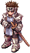

# :crossed_swords: Arena PvP

- Fale com a **Arena PvP** em Prontera (149,191) e escolha "Entrar na Arena PvP".
- Cada vitória na arena vale para o **[Ranking PvP](#ranking-pvp)** e dá **500 de cash**.
- A cada 50 vitórias você ganha o **[Emblema do Desafiante](#emblema-do-desafiante)**, a entrada da **[Copa Lothus](#copa-lothus)**.

!!! warning
    Na arena PvP você pode ser atacado por qualquer jogador. Não perde EXP ao morrer.

## Ranking PvP

{ loading=lazy }

Suba da **Divisão 10** até a **Divisão 1** e depois para a **Elite**. Veja a sua divisão com `@rankpvp` ou no NPC
(opção "Minha divisão"): o brasão da divisão aparece na tela com as vitórias da divisão, a sequência, a proteção e as vitórias da semana.

- **Vitória:** cada jogador que você derrota na Arena PvP. **Derrota:** morrer para outro jogador na Arena.
- **10 vitórias sobem 1 divisão** (o que passar de 10 já conta para a próxima). Ninguém cai de divisão por perder.
- **Embalo:** da **3ª vitória seguida** em diante, cada vitória vale **2**. Perdeu, volta 1 casa e o embalo zera.
- **Proteção:** ao chegar em **5 de 10** numa divisão, você ganha **3 proteções**: cada derrota gasta uma proteção em vez de voltar casa.
- **Elite:** cada vitória dá 1 ponto (2 no embalo) e cada derrota tira 1. O NPC mostra o **top 20 da Elite**.
- **Temporada = 1 mês.** No dia 1 os 20 primeiros da Elite ganham prêmio pelo correio e todos **descem 3 divisões** (a Elite volta para a Divisão 3).

!!! info "Abates que não contam"
    Não vale vitória (nem cash) derrotar personagem da **mesma conta**, do **mesmo IP**, ou o **mesmo jogador antes de 10 minutos**.

### Prêmio da semana

Com **10 vitórias na semana** (segunda a domingo), pegue no NPC (opção "Prêmio da semana") o prêmio da **divisão em que você está**, uma vez por semana.
Dica: suba de divisão antes de pegar. **VIP ganha +50%** nas Bandeiras e Moedas.

| Divisão | Prêmio da semana |
|---|---|
| 10 | 20 Bandeiras, 10 Moedas de Loki |
| 9 | 30 Bandeiras, 15 Moedas de Loki |
| 8 | 40 Bandeiras, 20 Moedas de Loki |
| 7 | 50 Bandeiras, 25 Moedas de Loki, 1 Caixa Misteriosa |
| 6 | 60 Bandeiras, 30 Moedas de Loki, 2 Caixas Misteriosas |
| 5 | 80 Bandeiras, 40 Moedas de Loki, 3 Caixas Misteriosas, 5 Moedas Douradas |
| 4 | 100 Bandeiras, 50 Moedas de Loki, 4 Caixas Misteriosas, 10 Moedas Douradas |
| 3 | 120 Bandeiras, 60 Moedas de Loki, 6 Caixas Misteriosas, 15 Moedas Douradas |
| 2 | 150 Bandeiras, 80 Moedas de Loki, 8 Caixas Misteriosas, 20 Moedas Douradas |
| 1 | 200 Bandeiras, 100 Moedas de Loki, 10 Caixas Misteriosas, 30 Moedas Douradas |
| Elite | 250 Bandeiras, 150 Moedas de Loki, 10 Caixas Misteriosas, 50 Moedas Douradas, 1 Martelo de Refinar Carta |

### Prêmio do mês (top 20 da Elite)

| Posição | Prêmio (pelo correio, no dia 1) |
|---|---|
| 1º | 1 Caixa Misteriosa Rara, 100 Moedas Douradas, 3 Martelos de Refinar Carta |
| 2º e 3º | 1 Caixa Misteriosa Rara, 60 Moedas Douradas, 2 Martelos de Refinar Carta |
| 4º a 10º | 5 Caixas Misteriosas, 40 Moedas Douradas, 1 Martelo de Refinar Carta |
| 11º a 20º | 5 Caixas Misteriosas, 20 Moedas Douradas |

## Emblema do Desafiante

A cada **50 vitórias válidas** na Arena PvP você ganha **1 Emblema do Desafiante** (um por vez; enquanto tiver um, o próximo espera).
Ele é a entrada da **Copa Lothus**. Não pode ser negociado, vendido nem largado. O painel do `@rankpvp` mostra quantas vitórias faltam.

## Copa Lothus

A **competição semanal x1**. Menu no NPC Arena PvP (opção "Copa Lothus") ou com `@copa`.

- **Inscrição:** gaste o Emblema do Desafiante e ganhe **30 lutas** na semana (uma inscrição por semana).
- **Horário:** sábado das 10h às 22h e domingo das 10h às 18h. Resultado e prêmios **domingo às 18h, pelo correio**.
- **Fila:** `@copa` e "Entrar na fila". Quando a fila acha 2 jogadores, os dois vão direto para uma **sala só deles** e lutam até **3 minutos**.
- **Vitória = 1 ponto.** Quem sai ou desconecta perde a entrada e o outro ganha o ponto. Tempo esgotado: vence quem tem mais % de HP.
- No máximo **5 lutas contra o mesmo adversário** por semana; jogadores do mesmo IP não se enfrentam.
- Sem perda de EXP. No fim da luta você volta para onde estava. Aprendiz e Super Aprendiz não lutam.

| Pontos no fim da Copa | Prêmio (VIP +50% nas Bandeiras e Moedas) |
|---|---|
| 30 | 5 Caixas Misteriosas, 5 Álbuns de Cartas Lendários, 40.000.000z, 300 Bandeiras, 2.000 Moedas de Loki, 100 Moedas Douradas |
| 25 a 29 | 4 Caixas Misteriosas, 3 Álbuns de Cartas Lendários, 25.000.000z, 200 Bandeiras, 1.200 Moedas de Loki, 60 Moedas Douradas |
| 20 a 24 | 3 Caixas Misteriosas, 2 Álbuns de Cartas Lendários, 15.000.000z, 150 Bandeiras, 800 Moedas de Loki, 40 Moedas Douradas |
| 15 a 19 | 2 Caixas Misteriosas, 1 Álbum de Cartas Lendário, 8.000.000z, 100 Bandeiras, 500 Moedas de Loki, 25 Moedas Douradas |
| 10 a 14 | 1 Caixa Misteriosa, 4.000.000z, 60 Bandeiras, 250 Moedas de Loki, 15 Moedas Douradas |
| 5 a 9 | 2.000.000z, 30 Bandeiras, 100 Moedas de Loki, 5 Moedas Douradas |
| 0 a 4 | 10 Bandeiras |

## Arenas Privadas

{ align=right loading=lazy }

O NPC **Arenas Privadas** (Prontera 153,191, ao lado da Arena PvP) aluga uma arena PvP **só sua por 1 hora** por **200.000z**:

- 5 mapas, com 8 salas cada.
- A arena fica trancada com um **código de 6 letras**. Só entra quem tiver o código: passe para quem você quiser chamar.
- Até 20 pessoas por sala.
- "Ver o código da minha arena" mostra de novo o código das arenas que você alugou.

## Guerra de Guildas

{ align=right loading=lazy }

A luta começa agora! Na sala do **Oficial de Guerra** (Prontera 151,191, ao lado da Arena PvP) as guildas resolvem suas rivalidades:

- No máximo **2 guildas** na sala por vez.
- Só entram **membros das guildas** (as duas primeiras que entrarem). Quando uma guilda sai inteira, a vaga fica livre.
- Membros de guildas diferentes podem se atacar.
