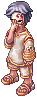

# :alarm_clock: Eventos automáticos

Eventos que começam sozinhos. O prêmio é em  **Moedas de Loki** (o Resta 1 também dá Bandeiras e Moedas Douradas).
A **Agenda de Eventos**, em Prontera (168,178), mostra os eventos de hoje e da semana. Na [Central do Aventureiro](../npcs/central-aventureiro.md) fica um NPC de cada evento, que explica as regras e diz quando é o próximo.

Nos eventos com inscrição, o servidor avisa **minuto a minuto nos 5 minutos antes de começar**, e a inscrição fica aberta durante esse aviso (`@evento`, ou `@piquepega` no Pique-pega, ou pelo NPC do evento).

## De dia (9h às 19h), todo dia

| Evento | Quando | Prêmio |
|---|---|---|
| :performing_arts: Disfarce | 9h, 11h, 13h, 15h e 17h | 5 Moedas por acerto |
| :question: [Quiz](quiz.md) | 10h30, 12h30, 14h30, 16h30 e 18h30 | Moedas de Loki e Moeda Dourada por acerto |
| :mushroom: Caça ao Cogumelo | Toda hora, às :45 (9h45 às 21h45) | 4 Moedas por cogumelo |
| :gem: [Invasão de Cristais](invasao.md) | Domingo, 10h às 11h | Bandeiras em dobro |

No domingo não tem o Quiz das 10h30 nem o Disfarce das 11h, por causa da Invasão.

## À noite (19h às 22h)

Os eventos da noite **mudam todo mês** (rotação mensal). Todo mês ficam: o [Evento dos Cristais](cristais.md) (**domingo, quarta e sábado às 20h**), o [Torneio de Duelo de Cartas](../sistemas/duelo-cartas.md#torneio-semanal) (**sábado às 21h15**), o Disfarce, o Quiz, a Caça ao Cogumelo, a Invasão de Cristais, as loterias e a [Guerra de Facção](../sistemas/faccoes.md#guerra-de-faccao) (última sexta do mês, 21h).
Dos outros dezesseis (Resta 1, Dados, Bombring, Pique-pega, [Detetive](detetive.md), [Pique-gema 3x3](pique-gema.md), [Combate dos Cubos](combate-dos-cubos.md) e os nove eventos novos: [Batatinha Frita](#batatinha-frita-1-2-3), [Chão que Cai](#chao-que-cai), [Infectados](#infectados), [Prop Hunt](#prop-hunt), [Captura da Bandeira](#captura-da-bandeira), [Forca](#forca), [Seja o MVP](#seja-o-mvp), [Extração](#extracao) e [Rei do Emperium](#rei-do-emperium)), **4 entram em cada mês**: sempre um entre Pique-gema e Combate dos Cubos (eles se alternam) e três dos outros, dando a vez a quem ficou de fora no mês anterior.
Os horários são 19h, 19h30, 20h e 21h (ou 21h15 depois dos Cristais). A troca é no dia 1, com aviso no servidor. A **Agenda de Eventos** mostra a semana do mês e a opção **Rotação do mês**.

**Novembro de 2026:** Combate dos Cubos, Bombring, Pique-pega e Dados.

| Evento | Prêmio |
|---|---|
| :crossed_swords: Resta 1 | 100 Bandeiras + 75 Moedas de Loki + 20 Moedas Douradas + 1 Caixa Misteriosa |
| :package: [Combate dos Cubos](combate-dos-cubos.md) | 1º: 100 Bandeiras + 75 Moedas de Loki + 20 Moedas Douradas + 1 Caixa Misteriosa; 2º e 3º também ganham |
| :gem: [Pique-gema 3x3](pique-gema.md) | Vitória: 60 Bandeiras + 40 Moedas de Loki + 10 Moedas Douradas para cada um do time; empate e derrota também ganham |
| :mag: [Detetive](detetive.md) | Quem resolve o caso: 150 Bandeiras + 100 Moedas de Loki + 30 Moedas Douradas; quem fica até o fim: 20 Bandeiras |
| :game_die: Dados | 75 Moedas para o vencedor |
| :bomb: Bombring | 75 Moedas para o vencedor |
| :runner: Pique-pega | 30 Moedas para quem sobrar; 3 por pegada |
| :traffic_light: Batatinha Frita 1, 2, 3 | 25 Moedas para quem cruzar a linha; o 1º ganha 50 Moedas + 5 Moedas Douradas |
| :hole: Chão que Cai | 75 Moedas + 10 Moedas Douradas para o último de pé; 2º: 25 Moedas |
| :zombie: Infectados | 30 Moedas para quem sobreviver; 3 por infecção para os zumbis |
| :herb: Prop Hunt | 40 Moedas para quem ficar escondido; 5 por achado para os caçadores |
| :triangular_flag_on_post: Captura da Bandeira | Vitória: 60 Bandeiras + 40 Moedas de Loki + 10 Moedas Douradas; empate e derrota também ganham |
| :abc: Forca | 1 Moeda por letra certa; 10 Moedas por palavra |
| :japanese_ogre: Seja o MVP | MVP que sobrevive: 100 Moedas + 50 Bandeiras + 1 Caixa Misteriosa Rara; último golpe: 50 Moedas + 1 Caixa Misteriosa |
| :desert: Extração | O que você achar nos baús, se chegar a uma saída (+10 Moedas) |
| :crown: Rei do Emperium | 1º: 75 Moedas + 20 Moedas Douradas + 50 Bandeiras; 2º e 3º também ganham |

## Resta 1

{ align=right loading=lazy }

PvP de **todos contra todos** numa arena em espiral: o último que ficar de pé ganha.

1. Nos 5 minutos antes (veja os dias e horários acima), digite **`@evento`** para se inscrever (precisa de pelo menos 3 jogadores).
2. Na hora, cada um aparece num **lugar aleatório** da arena. Não tem limite de jogadores. Você tem **10 segundos** para se preparar, depois o PvP começa.
3. Grupo e guilda não protegem: todo mundo é inimigo. Não dá para sair da arena nem usar teleporte, e a morte **não tira EXP**.
4. Cada abate dá **3 Bandeiras** na hora. **Quem morre sai do evento:** volta vivo para onde estava antes de entrar.
5. A partir do 2º minuto, o **radar** mostra a cada minuto onde estão os jogadores vivos.
6. O PvP dura até **10 minutos**. Se o tempo acabar com mais de um vivo, ganha quem tem mais abates (se empatar, ninguém ganha).

**Prêmios (pelo correio):**

- :trophy: **Vencedor:** 100 Bandeiras, 75 Moedas de Loki, 20 Moedas Douradas e 1 Caixa Misteriosa.
- :second_place: **2º lugar** (o último a cair): 30 Bandeiras e 25 Moedas de Loki.

## Disfarce

{ align=right loading=lazy }

O NPC **Disfarce** (Prontera 150,172) vira um monstro aleatório, 10 vezes seguidas.
**Grite o nome do monstro no chat perto do NPC.** Quem acertar primeiro ganha 5 Moedas de Loki. Cada rodada dura até 60 segundos.
Vale o **nome oficial em português** do monstro (o mesmo da carta dele, ex.: `Poring`, `Zangão`, `Lunático`, `Flor do Luar`), com ou sem acento. O nome em inglês também vale.

## Caça ao Cogumelo

90 **Cogumelos Negros** aparecem numa cidade sorteada. Cada um que você derrotar vale **4 Moedas de Loki**, e o servidor anuncia quem caçou e quantos ainda restam.
A caça acaba quando todos forem derrotados, depois de 1 hora ou às 22h. O **Caçador de Cogumelos** (Prontera 136,178) diz em qual cidade eles estão.

## Dados

1. Nos 5 minutos antes, digite **`@evento`** (precisa de pelo menos 4 jogadores).
2. Todos vão para uma sala com **4 caixas**: 1 (noroeste), 2 (nordeste), 3 (sudoeste) e 4 (sudeste). Tem uma placa no meio de cada caixa.
3. A cada rodada, entre numa caixa. O dado rola de 1 a 4: quem está na caixa sorteada continua, o resto sai.
4. A cada 4 rodadas vem uma pergunta de **Verdadeiro** (caixas da esquerda, 1 e 3) ou **Falso** (caixas da direita, 2 e 4).
5. O último que sobrar ganha **75 Moedas de Loki** pelo correio. Se ninguém sobrar, não tem vencedor.

## Bombring

1. Nos 5 minutos antes, digite **`@evento`** (precisa de pelo menos 4 jogadores).
2. Na arena, **bombas marcam o chão** onde vai explodir: saia de perto delas antes da explosão!
3. Cada rodada tem mais bombas e o aviso é mais rápido. Não dá para usar habilidades.
4. Quem morre volta para onde estava, com o HP que tinha. A morte não conta como morte normal.
5. O último vivo ganha **75 Moedas de Loki** pelo correio.

## Pique-pega

1. Nos 5 minutos antes, digite **`@piquepega`** (precisa de pelo menos 4 jogadores).
2. Todos entram **sem equipamento**: tudo é desequipado ao entrar e não dá para equipar lá dentro.
3. Há **1 pegador a cada 5 jogadores**, com **aura vermelha**. Os pegadores encostam nos outros para pegar.
4. Quem é pego fica **congelado por 10 segundos**. Pego **3 vezes**, sai do jogo e volta para onde estava.
5. O jogo dura 5 minutos. Quem sobrar ganha **30 Moedas de Loki**; cada pegador ganha **3 Moedas por pegada**.

## Batatinha Frita 1, 2, 3

1. Nos 5 minutos antes, digite **`@evento`** (precisa de pelo menos 3 jogadores).
2. Todos largam juntos de um lado da sala. Do outro lado fica a **Boneca**.
3. Quando ela diz **"Batatinha frita..."** e fica de costas, ande. Quando grita **"1, 2, 3!"** e vira, **pare**: quem se mexer com ela olhando sai do jogo.
4. Todos andam na mesma velocidade e não dá para usar habilidades.
5. Quem **cruzar a linha de chegada** em 2 minutos ganha **25 Moedas de Loki**; o 1º ganha **50 Moedas de Loki e 5 Moedas Douradas**.

## Chão que Cai

1. Nos 5 minutos antes, digite **`@evento`** (precisa de pelo menos 3 jogadores).
2. O chão é feito de placas. **Pisou, a placa racha e cai** em pouco mais de 1 segundo: quem estiver em cima sai do jogo. Buraco não dá para atravessar.
3. Depois de 45 segundos, placas aleatórias também começam a cair, cada vez mais. Não fique parado!
4. O **último de pé** ganha **75 Moedas de Loki e 10 Moedas Douradas** (pelo correio); o 2º ganha 25 Moedas de Loki.

## Infectados

1. Nos 5 minutos antes, digite **`@evento`** (precisa de pelo menos 4 jogadores). Todos entram **sem equipamento**.
2. Alguns jogadores (1 a cada 6) começam como **zumbis**, com aparência de Zumbi e um pouco mais rápidos.
3. Zumbi que **encosta** num humano transforma ele em zumbi também. Ninguém sai: quem vira zumbi passa a caçar.
4. Depois de 4 minutos, quem ainda for humano ganha **30 Moedas de Loki**. Cada zumbi ganha **3 Moedas de Loki** por pessoa que infectou.

## Prop Hunt

1. Nos 5 minutos antes, digite **`@evento`** (precisa de pelo menos 4 jogadores). Todos entram **sem equipamento**.
2. 1 a cada 4 jogadores é **caçador**; os outros se **escondem** disfarçados de **planta, cogumelo, ovo ou pupa** (uma janela deixa escolher), no meio de **70 iscas iguais**. O nome que aparece no mouse é o do monstro.
3. Os escondidos têm **40 segundos**; os caçadores esperam em outra sala. Depois, os caçadores têm **4 minutos**.
4. Caçador derruba um escondido com 1 golpe. **Atacar uma isca tira 20% do HP** do caçador (sem HP, ele sai).
5. A cada 45 segundos as coisas escondidas **fazem barulho** (um emote em cima delas).
6. Escondido que sobrar até o fim ganha **40 Moedas de Loki**. Caçador ganha **5 Moedas por achado** (+10 se acharem todos).

## Captura da Bandeira

1. Nos 5 minutos antes, digite **`@evento`** (precisa de pelo menos 4 jogadores).
2. Time **Vermelho** (oeste) contra time **Azul** (leste), com o emblema do time em cima da cabeça. Habilidades liberadas.
3. Passe por cima da **bandeira inimiga** para pegar (você fica com aura e aparece no minimapa de todos). Leve até a **sua bandeira**, que precisa estar na base: é uma **captura** (+5 Bandeiras).
4. Quem carrega a bandeira e cai, solta: ela volta para a base. Quem cai volta para a base do time em 5 segundos.
5. **3 capturas** vencem; se o tempo (12 minutos) acabar, vence quem tiver mais.
6. **Prêmios (pelo correio):** vitória 60 Bandeiras + 40 Moedas de Loki + 10 Moedas Douradas; derrota 15 Bandeiras + 10 Moedas de Loki; empate 25 Bandeiras + 15 Moedas de Loki. Time com 1 jogador a menos ganha +25% de HP e de dano.

## Forca

Sem inscrição: o jogo é **no chat**, para o servidor inteiro.

1. São **5 palavras** do Ragnarok (cidades, classes, monstros, MVPs, itens e habilidades). A dica é a categoria.
2. Chute com **`#forca <letra>`** ou **`#forca <palavra>`** (acentos não importam). Cada pessoa chuta 1 vez a cada 2 segundos.
3. Letra certa: **1 Moeda de Loki**. Quem completa a palavra ganha **10 Moedas de Loki**.
4. Com **6 erros** a palavra enforca. Cada palavra tem 2 minutos.

## Seja o MVP

1. Nos 5 minutos antes, digite **`@evento`** (precisa de pelo menos 4 jogadores).
2. Um inscrito é sorteado e vira um **MVP gigante**: aparência de MVP, muito HP, o dobro de dano e menos dano recebido. Ele não pode usar itens.
3. Todos os outros são **caçadores** (não se atacam entre si). O MVP aparece no minimapa. Caçador que cai volta em 10 segundos.
4. Nos **5 primeiros minutos**, qualquer um pode entrar como caçador com `@evento`.
5. Dura **8 minutos**. Se o MVP sobreviver: **100 Moedas de Loki, 50 Bandeiras e 1 Caixa Misteriosa Rara** (e 3 Moedas por caçador que derrubou). Se cair: quem deu o **último golpe** ganha **50 Moedas de Loki e 1 Caixa Misteriosa**, e cada caçador ganha 15 Moedas de Loki.

## Extração

1. Nos 5 minutos antes, digite **`@evento`** (precisa de pelo menos 2 jogadores).
2. Todos largam juntos no centro do **labirinto da Pirâmide** (uma cópia só para o evento). O **PvP liga 7 segundos depois**: todos contra todos. Sem Asa de Mosca, Asa de Borboleta nem teleporte.
3. Há **60 baús** pelo labirinto (1 golpe abre). O que sai vai para a sua **bolsa do evento**, não para o inventário. Veja a bolsa com **`@bolsa`**.
4. Para levar a bolsa, chegue a uma **saída aberta** (portal azul num canto do labirinto, marcado no minimapa). Na largada abrem 2 saídas sorteadas; aos 6 minutos abrem as 4. Quem sai ganha também 10 Moedas de Loki.
5. **Quem cai perde a bolsa** (ela vai para quem derrubou), mas não perde equipamento nem EXP. Em 12 minutos o evento acaba e quem ficou lá dentro perde a bolsa.
6. Nos baús: Moedas de Loki, Bandeiras, Moedas Douradas, Elunium e Oridecon Enriquecidos, Goma de Mascar, Caixa Misteriosa, Ficha da Roleta e, com sorte, Caixa Misteriosa Rara.

## Rei do Emperium

1. Nos 5 minutos antes, digite **`@evento`** (precisa de pelo menos 3 jogadores).
2. PvP de **todos contra todos** numa arena. Quem quebrar o **Emperium** do centro vira o **Rei** (aura vermelha e marca no minimapa de todos).
3. Quem derrubar o Rei **toma a coroa** (+2 Bandeiras). Se o Rei cair de outro jeito, o Emperium volta ao centro em 5 segundos. Quem cai volta em 5 segundos, sem perder EXP.
4. Em **10 minutos**, ganha quem foi Rei por mais tempo (somando todas as vezes): **75 Moedas de Loki, 20 Moedas Douradas e 50 Bandeiras**. 2º: 30 Moedas de Loki e 15 Bandeiras. 3º: 15 Moedas de Loki.

## Invasão Noturna de Prontera

Uma vez por noite, num horário **surpresa entre 19h e 21h30**, monstros invadem Prontera em **3 ondas de 10 minutos** (níveis 1, 2 e 3). Cada onda traz **5 tipos de monstro** sorteados entre monstros que deixam cair itens úteis, e muitos de cada um, para facilitar os drops.

- Os monstros **não atacam primeiro** e vão embora no fim da onda se ninguém matar.
- Pode acontecer junto com outro evento.
- Cada monstro morto conta para a sua [facção](../sistemas/faccoes.md) (categoria Invasão Noturna). No fim, o servidor avisa quantos cada facção caçou.
- Começa depois da primeira semana do servidor aberto.

## Noite Assombrada

O dia e a noite seguem o relógio: **é noite das 19h às 6h** (a tela escurece nos campos e cidades).

- À noite, **mortos-vivos e demônios ficam mais fortes** (causam +20% de dano e recebem 10% a menos) e **dropam mais** (+25% de chance).
- Alguns monstros **só aparecem de noite**: Zumbis e Sussurros no campo ao sul de Prontera, Carniçais num campo de Payon, Espectros num campo de Geffen, Pesadelos num campo de Morroc e Dullahans nos arredores de Glast Heim.
