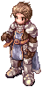
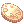
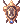

# :crossed_swords: Battleground

{ align=right loading=lazy }

**Batalhas de dois times**, o **Time Azul** contra o **Time Vermelho**. Cada noite de Battleground sorteia uma entre **9 batalhas diferentes**: captura de bandeira, mata-mata, controle de bases, castelos e mais.

## Quando e como entrar

- **Horário:** **segunda, terça, quinta e sexta às 21h40** (veja a [agenda da noite](automaticos.md#a-noite-19h-as-22h)). Cada batalha dura **até 15 minutos**.
- **Inscrição:** nos 5 minutos antes, o servidor avisa minuto a minuto qual batalha foi sorteada. Digite `@evento` (ou `@joinbg`) ou fale com o NPC **Battleground** na [Central do Aventureiro](../npcs/central-aventureiro.md) (parede da direita).
- **Chegou atrasado?** Com a batalha rodando, digite `@joinbg`: você entra no time com menos gente enquanto ela estiver rodando.
- Precisa ter **nível 60 ou mais**. Os times são montados na hora, sempre equilibrando o número de jogadores.
- Você entra com o seu personagem e o seu equipamento. **Morrer na batalha não tira EXP**: você volta para a base do seu time.
- `@leavebg` sai da batalha. No fim, **todos voltam para onde estavam** antes de entrar.
- `@bginfo` mostra a batalha que está rodando (jogadores, placar e tempo que falta).

## As 9 batalhas

| Batalha | Como vencer |
|---|---|
| :triangular_flag_on_post: **Captura do Cristal** | Pegue o cristal do inimigo e leve até o cristal da sua base. Quem marcar **3 pontos** vence (ou quem tiver mais no fim). Quem carrega o cristal não usa habilidades nem itens e perde HP aos poucos. |
| :skull_and_crossbones: **Mata-mata** | Cada time começa com **50 pontos** e perde um a cada morte. Vence quem deixar o outro sem pontos (ou com menos, no fim). |
| :rock: **Controle das Pedras** | Pegue as pedras do meio e leve para os pontos de pedra da sua base. Cada pedra dá pontos; o primeiro a **99** vence. Dá para roubar as pedras do inimigo! |
| :japanese_ogre: **Bossnia** | Cada time tem **5 guardiões MVP**. Para ferir os guardiões inimigos, o seu time precisa da **Bandeira do Equilíbrio**, no meio do mapa. |
| :classical_building: **Dominação** | Três bases (Norte, Centro e Sul): fique nelas para tomar. Cada base dá pontos a cada 5 segundos; o primeiro a **99** vence. |
| :cyclone: **Olho da Tempestade** | Duas bases (Norte e Sul) dão pontos a cada 5 segundos; com as duas, mais pontos. Leve a **Bandeira Neutra** do meio a uma base sua para ganhar pontos extras. O primeiro a **99** vence. |
| :fire: **Inferno Duplo** | Mate os inimigos, pegue as **caveiras** que caem e leve ao **Totem do Sacrifício** do seu time. Quem morre deixa cair todas as caveiras que carregava. O primeiro a **80 pontos** vence. |
| :european_castle: **Conquista** | Um time ataca o castelo e o outro defende. Quem ataca derruba as Pedras Guardiãs, os três portões e o Emperium; quem defende segura tudo até o tempo acabar. |
| :horse_racing: **Corrida ao Castelo** | Os dois times correm para tomar o castelo. Quem toma tem de defender; se perder, mate quem está lá e tome de volta. |

Na Dominação e no Olho da Tempestade, se ninguém chegar a 99 em 15 minutos, vence o time com mais pontos.

## Prêmios

| Resultado | Prêmio (pelo correio) |
|---|---|
| :trophy: Vitória |  **60 Bandeiras** +  **40 Moedas de Loki** +  **10 Moedas Douradas** + 1 ponto para a sua [facção](../sistemas/faccoes.md) |
| Derrota ou empate |  **15 Bandeiras** +  **10 Moedas de Loki** |

Além disso, todo mundo que termina a batalha ganha **emblemas de batalha** direto no inventário (mais para quem vence):
 **Emblema de Bravura** ou  **Emblema de Valor**, conforme a batalha.

## Sala de Batalha

O NPC Battleground leva para a **Sala de Batalha**. Lá ficam:

- **Erundek:** troca os emblemas por armas, armaduras, capas, sapatos e as Medalhas de Honra de cada classe. Os itens de recompensa **ficam presos ao personagem**.
- **Telma:** troca emblemas por consumíveis (poções, frascos, gemas, Poção de Velocidade, Teia de Aranha).
- **Recrutador:** explica cada batalha.
- Teleportadora (volta para o seu ponto de retorno), Kafra e Reparador.
- As salas de espera das batalhas clássicas **Flavius**, **Tierra** e **KvM** (nível 80+), que começam quando juntam jogadores suficientes nos dois lados.

## Líder do time

O primeiro a entrar em cada time é o **líder** (aparece na janela de guilda do time, que também mostra os abates de cada um). O líder tem comandos próprios:

| Comando | O que faz |
|---|---|
| `@order <mensagem>` | Manda um aviso grande na tela para o time todo |
| `@leader <nome>` | Passa a liderança para outro jogador do time |
| `@reportafk <nome>` | Tira do time quem está ausente (parado há 45 segundos ou mais) |
| `@bgskill <sigla>` | Usa uma habilidade de guilda no time (BO Ordem de Batalha, RG Regeneração, RS Restauração, EC Chamado de Emergência e outras), com tempo de recarga |

Quem fica **parado 45 segundos** recebe um aviso; com **90 segundos** é tirado da batalha.

## Outros comandos

| Comando | O que faz |
|---|---|
| `@bgranking` | Ranking de cada batalha: os 10 com mais vitórias (e abates) |
| `@listenbg` | Liga ou desliga os avisos de Battleground no chat |
