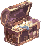
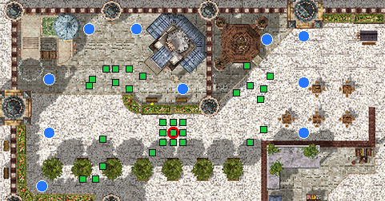

# :package: Combate dos Cubos

{ align=right loading=lazy }

**Evento de sobrevivência**, todos contra todos, numa arena no centro da cidade de **Doubrius**.
O objetivo é **ficar no top 3**: quebre os baús, junte **Cubos de Poder** para ficar mais forte e aguente o máximo que puder antes que a **névoa venenosa** feche o mapa.

## Quando e como entrar

- **Horário:** às **19h30** de **terça, quinta, sexta e domingo** (veja a [agenda da noite](automaticos.md#a-noite-19h-as-22h)).
- **Inscrição:** nos 5 minutos antes, o servidor avisa minuto a minuto. Digite `@evento` ou fale com o NPC **Combate dos Cubos** na [Central do Aventureiro](../npcs/central-aventureiro.md) (parede da direita).
- Precisa de pelo menos **2 jogadores**. Cada sala tem **até 10**: com mais gente, abrem mais salas ao mesmo tempo, e cada sala tem o seu vencedor.
- Você entra com o seu personagem e o seu equipamento. Quando cai (ou quando o combate acaba), vai **direto para Prontera**.
- :no_entry: **Aprendiz e Super Aprendiz não participam** (por causa da habilidade Fingir de Morto).

## Os baús e os Cubos de Poder

{ align=right loading=lazy }

- Os **baús** (sem nome) estão sempre nos mesmos lugares. Todo golpe tira só 1 de vida do baú, então **qualquer classe quebra um baú com 12 golpes**.
- Cada baú quebrado solta 1 **Cubo de Poder** no chão. É só pegar.
- **Cada cubo dá +10% de HP máximo** (e cura esse tanto na hora) **e +5% de dano**, físico e mágico, até o fim do combate.
- Quem cai **solta todos os cubos** que tinha, no lugar onde caiu.

## Ver a força dos outros

**Passe o mouse em cima de um jogador** para ver quantos cubos ele tem (aparece "N Cubos" no nome).
O número muda na hora, sempre que alguém pega um cubo, e todo mundo da sala recebe um aviso.

## A arena

- :large_blue_circle: **Largadas (azul):** 10 lugares fixos, todos à **mesma distância andando** do centro.
- :green_square: **Baús (verde):** cada largada tem 1 ou 2 baús **no caminho para o centro**, um pouco longe de onde você nasce. Fique atento: no caminho você pode cruzar com um vizinho.
- :red_circle: **Centro (vermelho):** **10 baús bem juntos**. Vale muito, mas todo mundo vai querer, e a briga é certa.
- O centro aparece marcado no seu minimapa durante o combate.

## A névoa venenosa

- Depois de **40 segundos**, a névoa começa a fechar o mapa, das bordas para o centro (pela distância andando), **1 passo a cada 5 segundos**. A borda da névoa aparece como uma **fumaça** no chão: não passe dela.
- Por volta dos **3 minutos e meio** ela chega nas largadas; por volta dos **6 minutos e meio** só sobra uma roda pequena no meio.
- Quem fica na névoa perde **5% do HP máximo a cada 2 segundos**, e o veneno fica mais forte a cada minuto (até 20%).
- O combate dura no máximo **8 minutos**. Se o tempo acabar com mais de um vivo, vence quem tem **mais cubos** (empate: mais abates).

## Prêmios (por sala)

O prêmio chega **assim que você aparece em Prontera**: o 3º e o 2º recebem ao cair, e o vencedor (o último de pé) é levado para Prontera e recebe na hora. Se estiver sem peso livre, o prêmio vai pelo correio.

| Colocação | Prêmio |
|---|---|
| :first_place: 1º lugar | 100 Bandeiras + 75 Moedas de Loki + 20 Moedas Douradas + 1 Caixa Misteriosa |
| :second_place: 2º lugar | 30 Bandeiras + 25 Moedas de Loki |
| :third_place: 3º lugar | 15 Bandeiras + 10 Moedas de Loki (sala com 3 ou mais) |
| :crossed_swords: Cada abate | 3 Bandeiras na hora |

Não se perde EXP no Combate dos Cubos. Não dá para usar teleporte, Asa de Borboleta nem galhos lá dentro.
