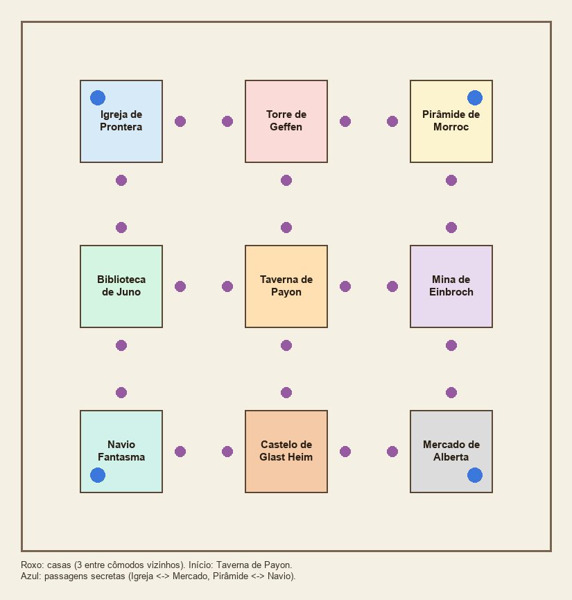

# :mag: Detetive

{ align=right loading=lazy }

**Jogo de tabuleiro de dedução:** alguém cometeu um crime em Rune-Midgard. Descubra **quem foi** (a profissão),
**com qual arma** e **onde**, antes dos outros detetives da mesa.

## Quando e como entrar

- **Horário:** **quinta às 21h** (veja a [agenda da noite](automaticos.md#a-noite-19h-as-22h)).
- **Inscrição:** nos 5 minutos antes, o servidor avisa minuto a minuto. Digite `@evento` ou fale com o NPC **Detetive** na [Central do Aventureiro](../npcs/central-aventureiro.md) (parede da direita).
- Cada mesa tem de **3 a 6 jogadores**. Com mais gente, abrem mais mesas ao mesmo tempo, e cada mesa tem o seu caso.
- Qualquer classe participa (até Aprendiz): ninguém luta, é só cabeça.

## O caso

- Ao começar, cada jogador vira uma **profissão sorteada**, com a roupa dela: **Cavaleiro, Mago, Arqueiro, Mercador, Gatuno ou Sacerdote**.
- Um **envelope secreto** guarda a solução: **1 profissão** (o culpado), **1 arma** e **1 local**.
- As outras cartas são divididas entre os jogadores. **As suas cartas não estão no envelope.**

| Profissões | Armas | Locais |
|---|---|---|
| Cavaleiro | Espada | Igreja de Prontera |
| Mago | Arco | Torre de Geffen |
| Arqueiro | Cajado | Pirâmide de Morroc |
| Mercador | Katar | Biblioteca de Juno |
| Gatuno | Maça | Taverna de Payon |
| Sacerdote | Livro | Mina de Einbroch |
| | | Navio Fantasma |
| | | Castelo de Glast Heim |
| | | Mercado de Alberta |

A sua própria profissão também pode ser a culpada!

## O tabuleiro

- São **9 cômodos**. Entre dois cômodos vizinhos há **3 casas**; todos começam na **Taverna de Payon**.
- Os cômodos dos cantos têm **passagens secretas**: Igreja de Prontera ↔ Mercado de Alberta e Pirâmide de Morroc ↔ Navio Fantasma.
- Você **não anda sozinho**: o jogo leva a sua peça (o seu personagem) pelo tabuleiro.

## A sua vez (60 segundos)

Quando chega a sua vez, abre uma janela. Você pode:

- :game_die: **Rolar o dado** (1 a 6) e escolher para qual cômodo ir. Todos veem o dado em cima da sua cabeça. Se tirar o bastante, você entra no cômodo; senão, anda até lá e continua na próxima vez.
- :door: **Usar a passagem secreta**, se estiver num canto: vai direto para o canto oposto.
- :speech_balloon: **Dar um palpite** quando entra num cômodo: escolha uma profissão e uma arma; o local é o cômodo onde você está.
- :rotating_light: **Acusar**, quando tiver certeza.
- **Passar a vez.**

Se não jogar em 60 segundos, perde a vez. Quem perde a vez 3 vezes seguidas sai da mesa.

## Palpite

- A profissão do palpite, se for de alguém da mesa, é **chamada para o cômodo** (e na vez dela pode dar um palpite ali sem andar).
- Seguindo a ordem da mesa, o **primeiro jogador que tiver uma das 3 cartas** mostra **uma só**, e **só para você**. Os outros veem apenas que ele mostrou uma carta.
- Quem tem mais de uma escolhe qual mostrar (30 segundos; depois sai uma ao acaso).
- Se **ninguém** tiver nenhuma das 3 cartas... pense bem: as que não são suas podem estar no envelope!

## Acusação

- Escolha profissão, arma e local. **Acertou as 3, venceu** e o caso está resolvido.
- **Errou, está fora**: não joga mais, mas continua na mesa, e as suas cartas continuam aparecendo nos palpites dos outros.
- Se ninguém acertar em **30 minutos**, o envelope é aberto e a mesa termina sem vencedor.

## Anotações: `@detetive`

Digite **`@detetive`** a qualquer momento para ver:

- as **suas cartas** (azul), as que **já te mostraram** (cinza) e as que ainda são **suspeitas** (vermelho);
- quem está na mesa, com a profissão de cada um, quem errou a acusação e de quem é a vez.

Na sua vez, o `@detetive` também abre a janela da sua jogada (se você fechou sem querer).
Se o tabuleiro não aparecer no chão, use `@detetive` e escolha **desenhar de novo**.

## Prêmios (por mesa)

Se estiver sem peso livre, o prêmio vai pelo correio. Quem sai no meio do jogo não ganha prêmio.

| Resultado | Prêmio |
|---|---|
| :trophy: Resolveu o caso | 150 Bandeiras + 100 Moedas de Loki + 30 Moedas Douradas (+5 pontos para a sua [facção](../sistemas/faccoes.md)) |
| :handshake: Ficou até o fim (inclusive quem errou a acusação) | 20 Bandeiras |

Não dá para usar habilidades, itens, teleporte, Asa de Borboleta nem galhos na mesa.
