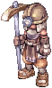
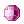
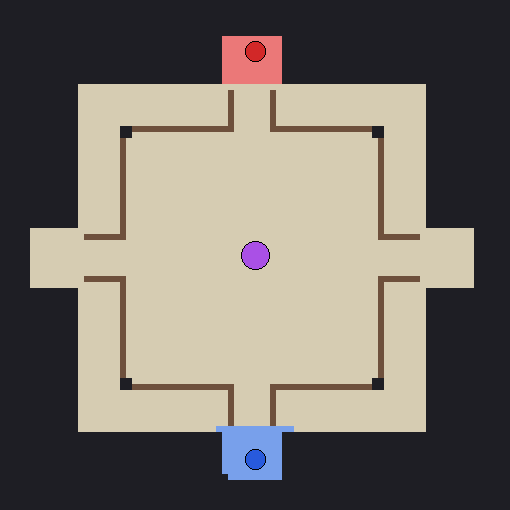

# :gem: Pique-gema 3x3

{ align=right loading=lazy }

**Evento de times:** o **Time Azul** e o **Time Vermelho**, com até 3 jogadores cada, disputam as gemas de uma mina no centro da arena.
Junte **10 gemas** no seu time e **segure por 15 segundos** para vencer.

## Quando e como entrar

- **Horário:** às **19h30** de **segunda, quarta e sábado** (veja a [agenda da noite](automaticos.md#a-noite-19h-as-22h)).
- **Inscrição:** nos 5 minutos antes, o servidor avisa minuto a minuto. Digite `@evento` ou fale com o NPC **Pique-gema** na [Central do Aventureiro](../npcs/central-aventureiro.md) (parede da direita).
- Precisa de pelo menos **2 jogadores** (aí é 1 contra 1). Cada sala tem **até 6** (3 contra 3): com mais gente, abrem mais salas ao mesmo tempo, e cada sala tem o seu vencedor.
- Os times são montados na hora. Se um time ficar com **1 jogador a menos**, ele ganha **+25% de HP e de dano** até o fim.
- Você entra com o seu personagem e o seu equipamento. No fim, todos voltam para **Prontera**.
- :no_entry: **Aprendiz e Super Aprendiz não participam** (por causa da habilidade Fingir de Morto).

## As gemas

{ align=right loading=lazy }

- A **mina** fica no centro da arena (marcada no seu minimapa) e solta **1 gema a cada 7 segundos**.
- É só **pegar a gema do chão**: ela conta para você e para o seu time.
- Quem cai **solta todas as gemas que tinha** no lugar onde caiu, e qualquer um pode pegar. Depois de **5 segundos** volta para a base do seu time.
- O **emblema em cima da cabeça** mostra o time de cada jogador. O **contador na tela** mostra as gemas do seu time / as gemas do outro time.

## Como vencer

- Quando um time tem **10 gemas ou mais** (e mais que o outro), começa uma **contagem de 15 segundos**. Se o time segurar até o fim, **vence**.
- Se o time cair para menos de 10 gemas, ou o outro time empatar ou passar, a contagem para.
- A partida dura no máximo **5 minutos**. Se ninguém segurar a contagem, vence o time com **mais gemas**; com o mesmo número, é empate.

## A arena

- :large_blue_circle: **Base do Time Azul** (sul) e :red_circle: **base do Time Vermelho** (norte).
- :purple_circle: **Mina de gemas** no centro.
- Os muros ao redor do centro dão cobertura: dá para fugir com as gemas ou fazer uma emboscada.

## Prêmios (por sala)

Se estiver sem peso livre, o prêmio vai pelo correio. Quem sai no meio da partida não ganha prêmio.

| Resultado | Prêmio (cada jogador) |
|---|---|
| :trophy: Vitória | 60 Bandeiras + 40 Moedas de Loki + 10 Moedas Douradas |
| :handshake: Empate | 25 Bandeiras + 15 Moedas de Loki |
| :shield: Derrota | 15 Bandeiras + 10 Moedas de Loki |
| :crossed_swords: Cada abate | 2 Bandeiras na hora |

Não se perde EXP no Pique-gema. Não dá para usar teleporte, Asa de Borboleta nem galhos lá dentro.
