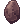
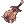
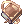

# :crossed_swords: Armas lendárias

Uma **arma lendária** para cada classe. Todas têm **2 slots**, nível da arma 4, pedem **nível 95** e não podem ser vendidas nem jogadas no chão.

## Como conseguir

-  **Caixa Lendária de Armamento:** dá a arma da sua classe. Quem é de 2ª classe e ainda não renasceu fica com a caixa (abra depois de renascer). As outras classes escolhem a arma.
  Vem da Caixa Misteriosa Rara (0,1%), do Trocador de Bandeiras (20.000), do Gerente de Moedas Douradas (5.000) (a caixa não sai mais do Evento de Lançamento).
- :shield: **Armamento Lendário** (Prontera 196,178): troca qualquer arma lendária, à sua escolha, por **20.000 Bandeiras + 10.000 Moedas de Loki + 2.000 Moedas Douradas**. As armas aparecem numa janela de loja; ao escolher uma, a janela mostra os itens pedidos e a troca só acontece se você tiver tudo.
- :hammer: **Forja Lendária** (Prontera 184,178): só **Ferreiro** ou **Mestre-Ferreiro** forja, qualquer arma da lista.

| Material | Quantidade |
|---|---|
|  Bênção do Ferreiro | 3 |
|  Oridecon Enriquecido | 10 |
|  Elunium Enriquecido | 10 |
|  Ouro | 20 |
|  Bandeira Nacional | 1.000 |
|  Moeda de Loki | 500 |
| Zeny | 10.000.000 |

Chance de **40%** (Mestre-Ferreiro **50%**). Se falhar, perde os minérios, o Ouro e as Bênçãos; as Bandeiras, as Moedas de Loki e o zeny voltam.

## As armas

| | Arma | Classe | ATQ | Bônus |
|---|---|---|---|---|
|  | Lâmina Lendária do Lorde | Lorde | 230 | FOR +3, velocidade de ataque +5%, Impacto de Tyr +25% (+15% no +9) |
|  | Lança Sagrada do Paladino | Paladino | 220 | VIT +3, arma Sagrada, Grand Cross +25%, Escudo Bumerangue +20%, +9: HP +10% |
|  | Machado Lendário do Mestre-Ferreiro | Mestre-Ferreiro | 240 | FOR +4, indestrutível, Terremoto de Carrinho e Mammonita +25%, +9: velocidade de ataque +10% |
|  | Machado Alquímico do Criador | Criador | 160 | VIT +3, INT +3, Demonstração Ácida +25%, +9: HP +10% |
|  | Katar Lendário do Algoz | Algoz | 160 | AGI +3, Crítico +10, Lâminas Destruidoras +25%, +9: velocidade de ataque +5% |
|  | Adaga Lendária do Desordeiro | Desordeiro | 150 | AGI +3, DES +2, Apunhalar +25% (+15% no +9), dano a distância +5% |
|  | Cajado Lendário do Arquimago | Arquimago | 60 | INT +4, ATQM +15% (+5% no +9), conjuração -10% |
|  | Livro Lendário do Professor | Professor | 120 | INT +3, ATQM +10%, Lanças de Fogo, Gelo, Raios e Terra +15% |
|  | Maça Sagrada do Sumo Sacerdote | Sumo Sacerdote | 130 | INT +3, Cura +15% (+5% no +9), Magnus Exorcismus +20% |
|  | Punhos Lendários do Mestre | Mestre | 150 | FOR +3, Asura +20%, Combo Triplo e Ataque Final +15% |
|  | Arco Lendário do Atirador de Elite | Atirador de Elite | 180 | DES +4, dano a distância +15%, Tiro Preciso +20% |
|  | Violão Lendário do Menestrel | Menestrel | 150 | DES +3, Vulcão de Flechas +25%, +9: dano a distância +10% |
|  | Chicote Lendário da Cigana | Cigana | 150 | DES +3, Vulcão de Flechas +25%, +9: dano a distância +10% |
|  | Livro Estelar do Mestre Taekwon | Mestre Taekwon | 130 | FOR +3, AGI +2, chutes +20% |
|  | Cajado Lendário do Espiritualista | Espiritualista | 60 | INT +3, ATQM +10%, Esma +25% |
|  | Huuma Lendária do Ninja | Ninja | 200 | FOR +3, DES +2, Arremessar Huuma +25%, Kunai +15% |
|  | Rifle Lendário do Justiceiro | Justiceiro | 170 | DES +4, Disparo Perfurante e Rastreamento +25%, dano a distância +5% |
|  | Adaga Lendária do Super Aprendiz | Super Aprendiz | 150 | Todos os atributos +3, HP e SP +10% |
