# :shield: Itens

Todos os itens do servidor estão na [Database de itens](../database/itens.md).

## Itens alterados

### Armas

| | Item | Mudança |
|---|---|---|
|  | Espada Elemental [3] | As Lanças de Gelo automáticas só saem da espada na **mão direita**; com duas espadas, a chance não soma |
|  | Jamadhar Glorioso | Não ignora mais 20% da defesa de humanoides; no lugar, **dano crítico +20%** |
|  | Cajado do Feiticeiro (Osso de Lich) | **Espiritualista** também equipa |
|  | Cajado Perfurante | **Espiritualista** também equipa |
|  | Cajado de Espinhos da Escuridão | **Espiritualista** também equipa |
|  | Arco de Luna | DEF +2, **+3** a partir do +6 e **+5** a partir do +9 (era 2/5/7) |
| 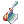 | Machado Veterano | ATQ +10 por habilidade de forja no **nível 2 ou mais** (antes só no 3) |
| 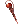 | Cajado de Cura | Também cai da **Margaretha Sorin** (Laboratório de Biologia) |
|  | Machado Vecer [2] | Agora cai do **Majoruros** |
| 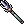 | Tridente [2] | Saiu das lojas de armas (Prontera, Comodo, Einbroch e Sala VIP). Cai do Merman e pode ser forjado. Um Tridente +10 vira [Lança Gigante](../sistemas/servicos.md#forjador-de-armas) |
| | Soqueiras | Dano em tamanho **pequeno 100%, médio 100% e grande 75%** (era 100/75/50) |

### Equipamentos

| | Item | Mudança |
|---|---|---|
|  | Botas Temporais | Bônus novos, veja [abaixo](#botas-temporais) |
|  | Chapéu de Pintinho | Também reduz em 3% o dano de monstros **Brutos** |
| | Máscara da Morte (Coroa da Mentira) | **INT +3** (era 4). Agora cai do **Bispo Decadente** |
|  | Boneca de Denise | Sem o FOR +2 |
|  | Boneca de Sofia | Sem o INT +2 |
|  | Chapéu de Abóbora do Festival | **Todos os atributos +3**; dano físico **e mágico** +5% contra Demônio; -5% de dano de Demônio |
|  | Chapéu de Cachorrinho | Com 77 ou mais de AGI base, a Glória automática sai com **5%** (era 3%) |
|  | Elmo do Rei Youkai | Nível necessário **1** (era 70) |
| | Chapéu de Jiboia (Cabeça de Cobra) | Sem slot. Agora cai do **Senhor das Serpentes** |
|  | Medalha de Honra | **Taekwon** também equipa |
|  | Piercing de Umbala | HP máximo +1% (no lugar de VIT +1); Carne recupera +25%; 1% de chance de ganhar Carne ao derrotar monstros |
|  | Poderoso Chapéu de Bruxa | DEF **1** (era 10) |

### Itens que agora caem de monstros

Chance antes das rates do servidor (no jogo, multiplique pela rate de drop: 9x na semana, 12x no fim de semana; MVPs 5x e 9x).

| | Item | Monstro | Chance |
|---|---|---|---|
|  | Chapéu de Hermod [1] | Algoz Eremes (Laboratório de Biologia) | 3% |
|  | Espírito Angelical | Valquíria Randgris | 0,45% |
|  | Olhos Biônicos | Vesper | 0,42% |
|  | Cajado de Cura | Margaretha Sorin | 0,2% |
| | | Anubis | 0,07% (era 0,1%) |
| | Máscara da Morte (Coroa da Mentira) [1] | Bispo Decadente | 1,2% |
|  | Asas de Sigrun | Grifo | 0,18% |
| | Chapéu de Jiboia | Senhor das Serpentes | 0,18% |
|  | Machado Vecer [2] | Majoruros | 0,04% |
|  | Broche de Bradium [1] | Golem de Bradium | 0,01% |
|  | Chapéu de Sting | Sting | 0,01% |

### Cartas

| | Carta | Mudança |
|---|---|---|
| 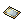 | Carta Flor do Luar | Velocidade de movimento **+40%** (era 25%) |
|  | Carta Presente (Caixa Misteriosa) | Caixa de Presente com **2,25%** (era 0,3%) |
|  | Carta Shinobi | A Furtividade automática **não funciona** com o conjunto das cartas de Gatuno equipado |
|  | Carta Relógio | Quando o Bloqueio sai de novo com ele já ativo, o tempo **renova** (antes desligava) |

### Consumíveis e outros

| | Item | Mudança |
|---|---|---|
|  | Asas de Mosca (normal, de Iniciante e Ilimitada) | Funcionam durante a **Fúria (Berserk)** |
| 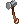 | Martelos de forja e kits de culinária | Só são gastos quando você **tenta criar** (abrir e fechar a janela não gasta mais) |
|  | Espelho Convexo | Uma vez a cada **60 minutos** |
| 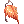 | Amuleto de Siegfried | Ressuscita **uma vez a cada 15 minutos** |
| 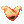 | Natureza Grandiosa | Não pode ser enviada pelo correio |
| | Todos os itens | Intervalo entre usos de itens de **0,05 s** (era 0,1 s) |

## Mudanças de 03/11

| | Item | Mudança |
|---|---|---|
|  | Bandeira Nacional | Peso **0,1** (era 1). Agora pode ser guardada no armazém, negociada, vendida para NPC e na loja de mercador |
|  | Carta Besouro-Ladrão Dourado | Reduz o dano mágico recebido em **40%** (não é mais imunidade) |
| 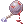 | Bola de Ferro Ensanguentada | Agora com **1 slot**. O bônus de conjunto (ATQ +50 e resistência a prisioneiros) vale com os Grilhões **e também com o Sleipnir**. Sai da Caixa Rara (1%) |
|  | Frigideira Lunar | **4 slots** (eram 3) |
|  | Olhos Biônicos | Agora com **1 slot** |
|  | Escudo de Escamas de Naga | Sai da Caixa Misteriosa (2%) |
| 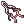 | Infiltrador | O da Caixa Misteriosa agora vem **com slot** |
|  | Caixa de Comidas +10 | Dá **10 de cada** comida +10 (antes era 1) |
|  | Velho Álbum de Cartas | Anuncia para o servidor a carta que saiu |
|  | Licença de Loja de Compra | Abre uma loja de compra com 5 itens; 20 Moedas de Loki |
| 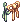 | Chapéu de Bandeira Brasileira | Ganhou sprite própria: boné com a bandeira do Brasil num mastro |
|  | Suco de Uva | 4.000z na Utilidades VIP |
|  | Ovo de Grand Orc | Novo nome do Ovo de Orc Superior |

### Visual da Fortuna

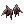 **Visual da Fortuna** (visual do meio, com a aparência das Asas Malignas). A cada monstro derrotado com ele equipado:
1% de chance de 1 Bandeira, 1% de 1 Moeda de Loki, 0,5% de 1 Moeda Dourada e 0,01% de um  **Martelo de Refinar Carta**
(para o refino de cartas, que chega em breve). Vem da Caixa Misteriosa Rara (0,5%), do Trocador de Bandeiras (15.000), do Gerente de Moedas Douradas (3.000)
e do Evento de Lançamento (300). O Martelo também sai das Caixas Misteriosas.

Armas lendárias: veja [Armas lendárias](armas-lendarias.md).

### Arco Élfico

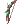 **Arco Élfico [2]**: ATQ 160, DES +2, nível 90, Arqueiros, Bardos, Odaliscas e evoluções.

- Com a  **Flecha Élfica**: dano físico a distância **+50%**.
- Com o **Tesouro do Arruaceiro** e o **Coração Gélido**: dano contra monstros de tamanho Médio **+20%**.
- Vem do [Forjador de Armas](../sistemas/servicos.md#forjador-de-armas) (Arco de Orc +10). A Flecha Élfica está na loja do Arqueiro, do Bardo e da Odalisca na Sala VIP.

### Lança Gigante e Chave Dourada

Novas armas do [Forjador de Armas](../sistemas/servicos.md#forjador-de-armas):
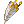 **Lança Gigante [2]** (Lorde e Paladino) e  **Chave Dourada [2]** (Mestre-Ferreiro).

### Cupons

| | Cupom | Onde usar |
|---|---|---|
|  | Cupom de Cor de Roupa | [Estilista](../sistemas/servicos.md#estilista) |
|  | Cupom de Cor Infinito | [Estilista](../sistemas/servicos.md#estilista): com ele no inventário, tudo de graça |
|  | Cupom de Troca de Nome | [Resgatador de Cupons](../sistemas/servicos.md#resgatador-de-cupons) |
|  | Cupom de Troca de Sexo | [Resgatador de Cupons](../sistemas/servicos.md#resgatador-de-cupons) |
|  | Cupom de Nome de Guilda | [Resgatador de Cupons](../sistemas/servicos.md#resgatador-de-cupons) |
|  | Cupom de Vaga de Personagem | [Resgatador de Cupons](../sistemas/servicos.md#resgatador-de-cupons) |
|  | Ficha de 1 Bilhão de Zeny | [Cambista do Bilhão](../sistemas/servicos.md#cambista-do-bilhao) |

## Itens novos e alterados (antes)

### Manto Demoníaco

Visual de cabeça (topo), presente de boas-vindas ([Começando](../primeiros-passos/comecando.md)).

- Todos os atributos +10
- HP máximo +5%, SP máximo +10%
- DEF +10
- **Só pode ser equipado até o nível 90.** Acima disso, sai do corpo sozinho.
- Preso à conta.

### Chapéu de Bebê Dragão

- Ataque Duplo nível 8 (era 5).
- Ao atacar: 5% de chance de Dilúvio nível 4 e 7% de Esferas d'Água nível 4.
- Esferas d'Água com +400% de dano.

### Chapéu de Rideword

30% de chance de converter 15% do dano físico em HP e 30% em SP.

### Boina Alada

DEF 11 (era 1).

### Botas Temporais

Botas de FOR, AGI, VIT, INT, DES e SOR, com slot, só para transclasse. Vêm do [Trocador de Bandeiras](../servidor/moedas.md#bandeira).
Todas dão HP máximo +300 e SP máximo +30, e mais HP +100 e SP +10 a cada 3 refinos:

| Bota | A cada 3 refinos | Com o atributo base alto |
|---|---|---|
| FOR | FOR +1 | FOR 90+: dano físico +5% |
| AGI | Velocidade de ataque +3% | AGI 90+: velocidade de ataque +3% |
| VIT | HP +200 (no lugar de +100) e HP +4% (base HP +500) | VIT 75+: HP +10% |
| INT | INT +1 e DES +1 | INT 90+: ATQM +5% |
| DES | DES +1 | DES 90+: dano a distância +5% |
| SOR | Dano crítico +5% | SOR 50+: dano crítico +10%; SOR 70+: dano crítico +15% e DEFM +5 |

### Arco dos Orcs [3]

Arco dos Orcs com 3 slots. O Orc Archer derruba o [3] com 0,1% e o normal com 1% (antes 0,02%).
Também sai da Caixa Misteriosa (1%).

### Slots extras

| Item | Slots |
|---|---|
| Rosa Romântica | 2 |
| Óculos Amorzinho (também +5 em todos os atributos) | 2 |
| Óculos [1] | 2 |
| Óculos Escuros [1] | 2 |

### Consumíveis

| Item | Mudança |
|---|---|
| Suco de Uva | Peso 0,5 (era 4); 4.000z na Utilidades VIP |
| Enciclopédia de Combate 200% | Dura 30 minutos |
| Chicle de Bola 200% | Dura 30 minutos |
| Manual de Classe 100% e 200% (novos) | EXP de classe +100% / +200% por 30 minutos |
| Manual de Combate 300% | EXP de base +300% por 30 minutos (só das caixas) |
| Goma de Mascar 250% | Drop +250% por 30 minutos (só das caixas) |
| Asa de Mosca Ilimitada | Asa de Mosca que não acaba |
| Bênção do Ferreiro | Protege o equipamento no refino. [Mestre Ferreiro](../sistemas/ferreiro-e-refino.md) |
| Agulha e Linha | Transforma um chapéu em visual. [Chapeleira](../sistemas/chapeleira.md) |

### Itens que vendem por menos para NPC

Para evitar lucro fácil: flechas, gemas, balas e outros consumíveis vendidos a 1 zeny nas lojas da Sala VIP
vendem por 0. Alguns itens (como Salada Verde, Espelho de Cristal, Rosa Congelada, Rosa Eterna, Khukri e anéis)
têm preço de venda menor.
