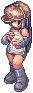
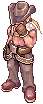

# :european_castle: NPCs de Prontera

## Perto da fonte

| | Posição | NPC | O que faz |
|---|---|---|---|
| { loading=lazy } | 149,193 | **Resetadora** | Reseta atributos e habilidades. Grátis até o nível 80; depois 1,5kk cada ou 2kk os dois |
| { loading=lazy } | 147,193 | **Gerente de Builds** | Guarda até 10 builds de atributos e 10 de habilidades. [Serviços](../sistemas/servicos.md#gerente-de-builds) |
| | 151,193 | **Removedora de Cartas** | Tira as cartas do equipamento por 350.000 zeny, sem risco |
| | 155,193 | **Curandeira** | Cura HP e SP, Aumentar Agilidade 10, Bênção 10 e conserta tudo. Grátis e sem espera |
| | 157,193 | **Platina** | Dá as habilidades de quest (platina) da sua classe. Vai mudar de lugar em breve |
| | 159,192 | **Teleportadora** | Cidades, cavernas e lugares especiais (detalhes abaixo) |
| { loading=lazy } | 146,197 | **Lotérica** | Loteria Semanal e Loteria Diária. [Loteria](../sistemas/rankings-e-loteria.md#loterias) |
| { loading=lazy } | 166,198 | **Chapeleira** | Transforma chapéus em visuais. [Chapeleira](../sistemas/chapeleira.md) |
| | 149,191 | **Arena PvP** | Leva para a [Arena PvP](../eventos/arena-pvp.md) e mostra o ranking |
| | 145,187 | **Kafra** | Salva o ponto de retorno em Prontera, abre o armazém e coloca ou tira Carrinho, Falcão e Peco Peco (precisa da habilidade). Grátis |
| | 148,182 | **Blackroom** | Leva para a [Blackroom](blackroom.md) |
| | 164,185 | **Mestra das Classes** | Muda de classe de graça: 1ª e 2ª classe, transclasse, Super Aprendiz, Taekwon, Ninja e Justiceiro. Já dá as habilidades de quest |
| | 180,185 | **Mestre das Habilidades** | Classes sem NPC próprio escolhem 1 habilidade de qualquer classe. [Classes](../mudancas/classes.md) |

## Praça ao sul da fonte

Uma fileira de NPCs de serviço, quase todos na linha 178:

| | Posição | NPC | O que faz |
|---|---|---|---|
| { loading=lazy } | 120,178 | **Troca de Cartas** | Troca cartas por pontos (Velho Álbum de Cartas, Galho Sangrento, Moedas de Loki). [Serviços](../sistemas/servicos.md#troca-de-cartas) |
| | 124,178 | **Quadro de Missões** | Missões repetíveis de entrega e de caça. [Missões](../sistemas/missoes.md#quadro-de-missoes) |
| { loading=lazy } | 128,178 | **Hobota** | Missões de Caça a cada 8 horas e Loja de Pontos de Missão. [Missões](../sistemas/missoes.md#hobota-missoes-de-caca) |
| { loading=lazy } | 136,178 | **Caçador de Cogumelos** | Diz onde está a Caça ao Cogumelo. [Eventos automáticos](../eventos/automaticos.md#caca-ao-cogumelo) |
| { loading=lazy } | 140,178 | **Banqueiro** | Banco de zeny da conta (também abre com `Ctrl+B`). [Serviços](../sistemas/servicos.md#banqueiro) |
| { loading=lazy } | 144,178 | **Resgatador de Cupons** | Troca de nome, de sexo, de nome da guilda e vaga de personagem. [Serviços](../sistemas/servicos.md#resgatador-de-cupons) |
| { loading=lazy } | 148,176 | **Guia dos Cristais** | Leva até o Guarda do [Evento dos Cristais](../eventos/cristais.md) |
| { loading=lazy } | 150,172 | **Disfarce** | Evento Disfarce nas horas ímpares. [Eventos automáticos](../eventos/automaticos.md#disfarce) |
| { loading=lazy } | 152,178 | **Estilista** | Cabelo e cor do cabelo grátis; cor da roupa 100.000z ou cupom. [Serviços](../sistemas/servicos.md#estilista) |
| { loading=lazy } | 156,178 | **Sala VIP** | Entrada da [Sala VIP](sala-vip.md) (só VIP) |
| { loading=lazy } | 160,178 | **Bill Doors** | Troca 1 bilhão de zeny por uma ficha e a ficha de volta. [Serviços](../sistemas/servicos.md#bill-doors) |
| { loading=lazy } | 164,178 | **Contratante** | Aluga a Sala de Galhos (120 min, 1.200.000z). [Serviços](../sistemas/servicos.md#sala-de-galhos) |
| { loading=lazy } | 168,178 | **Treinador** | Sala de Treino com bonecos para testar dano. [Serviços](../sistemas/servicos.md#sala-de-treino) |
| { loading=lazy } | 172,178 | **Oficial de Guerra** | Sala de Guerra de Guildas (2 guildas). [Arena PvP](../eventos/arena-pvp.md#guerra-de-guildas) |
| { loading=lazy } | 176,178 | **Arenas Privadas** | Aluga uma arena PvP com código. [Arena PvP](../eventos/arena-pvp.md#arenas-privadas) |
| { loading=lazy } | 180,178 | **Forjador de Armas** | Transforma armas +10 em armas melhores. [Serviços](../sistemas/servicos.md#forjador-de-armas) |

## :crystal_ball: Teleportadora

Fica em 23 cidades, ao lado da entrada da Sala VIP.

- **Último destino:** volta para o último lugar que você escolheu.
- **Cidades:** grátis, separadas por região.
- **Cavernas:** 1º andar, separadas por dificuldade (iniciante, intermediária e avançada). **Grátis até o nível 90**, 5.000 zeny acima.
- **Especiais:** Geffenia (sem a quest O Sinal) e Ninho de Nidhogg (Sombra de Nidhogg), cobrados como caverna.
- Poringlândia fica nas cavernas de iniciante.

A [Teleportadora VIP](sala-vip.md) leva para qualquer andar, de graça.
