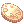

# :coin: Moedas e trocas

O servidor tem três "moedas" de prêmio, todas trocadas na [Blackroom](../npcs/blackroom.md).

##  Moeda de Loki

- **5% de chance** em quase todo monstro, direto no inventário. Não muda com as rates.
- Sem moeda: plantas, cogumelos, ovos, Hydra, Thief Bug, Tarou e Plankton.
- Chance menor (2%): Orc Zombie, Thief Bug fêmea e macho e Familiar.
- Também vem do [Quiz](../eventos/quiz.md), dos [eventos automáticos](../eventos/automaticos.md), da [Arena Lothus](../eventos/arena-lothus.md), da [Troca de Cartas](../sistemas/servicos.md#troca-de-cartas) e do [login diário](../sistemas/login-diario.md).
- Vende para NPC por 10.000 zeny.
- Pode ser negociada com outros jogadores (troca ou loja).

**Trocadora de Moedas** (Blackroom 88,100), alguns preços em Moedas de Loki:

| Item | Preço |
|---|---|
| Comida +10 (cada) | 50 |
| Grimório (Manual de Combate 100%) | 150 |
| Manual de Classe 100% | 150 |
| Manual de Classe 200% | 300 |
| Enciclopédia de Combate 200% (30 min) | 300 |
| Goma de Mascar 100% | 600 |
| Chicle de Bola 200% (30 min) | 1.200 |
| Bênção de Tyr | 50 |
| Galho Sangrento | 270 |
| Asa de Mosca Ilimitada | 700 |
| Velho Álbum de Cartas | 300 |
| Licença de Loja de Compra | 20 |
| Passe Anti-Gravitacional | 300 |

A loja também tem poções, Yggdrasil, Carta Kafra, Galhos Secos e Asa de Mosca Ilimitada.

##  Moeda Dourada

- **Presença:** 1 moeda a cada 6 minutos online (10 por hora). Não conta quem está parado há 5 minutos, com loja aberta (inclusive `@autotrade`) ou em chat. A cada moeda o chat mostra **há quanto tempo você está online** e **quantas moedas de presença ganhou** nesta sessão (volta do zero quando você sai do jogo). O `@pontos` também mostra.
- **MVP:** 15 moedas para quem mata um MVP.
- Também vem do [Quiz](../eventos/quiz.md), da [Torre MVP](../sistemas/mvps.md#torre-mvp) e da [Arena Lothus](../eventos/arena-lothus.md).
- `@pontos` mostra quantas você tem.
- Pode ser negociada com outros jogadores (troca ou loja). Não vende para NPC.

**Gerente de Moedas Douradas** (Blackroom 88,94):

| Item | Preço |
|---|---|
| 50 Moedas de Loki | 200 |
| 100 Bandeiras | 300 |
| Ovo Misterioso | 300 |
| Velho Álbum de Cartas | 250 |
| Caixa Misteriosa Rara | 700 |
| Ovo Lendário | 700 |

##  Bandeira

- Vem do [Evento dos Cristais](../eventos/cristais.md), da [Invasão de Cristais](../eventos/invasao.md) e das [Caixas de Bandeiras](../sistemas/caixas-e-ovos.md#caixas-de-bandeiras).
- Peso 0,1. Pode ser guardada no armazém, negociada e vendida na loja de mercador.

**Trocador de Bandeiras** (Blackroom 112,100):

| Item | Preço |
|---|---|
| Chapéu de Bandeira Brasileira (+25% de velocidade) | 100 |
| 335 chapéus do bRO (2 lojas) | 200 cada |
| Carta Flor do Luar | 500 |
| Grimório | 500 |
| Manual de Classe | 600 |
| Boina Alada (DEF 11) | 600 |
| Bilhete VIP 30 dias | 800 |
| Enciclopédia de Combate | 900 |
| Botas Temporais (FOR, AGI, VIT, INT, DES ou SOR, com slot, só transclasse) | 1.000 |
| Chapéu de Rideword | 2.000 |
| Ovo Misterioso | 2.000 |
| Ovo Lendário | 4.000 |
| Álbum de Cartas Lendário | 4.000 |
| Caixa Misteriosa Rara | 5.000 |

Nenhuma troca dá ROPs (cash).
