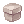
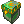
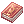
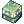
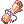
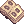
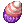

# :package: Caixas e ovos

!!! tip "Lista completa"
    Tudo o que sai de cada caixa, ovo e álbum, com a chance de cada prêmio, está em
    [O que sai das caixas](conteudo-caixas.md).

!!! warning "Peso"
    Caixas, ovos e álbuns **não abrem** se você estiver com excesso de peso (50% ou mais) ou com o inventário quase cheio.
    Aparece um aviso e o item continua com você.

##  Caixa Misteriosa

- Vendida pela **Vendedora de Caixas** (Blackroom 112,94) por **900.000 zeny**.
- Mais de 120 prêmios em faixas de raridade: **S** (0,01% cada), **A** (0,1%), **B** (0,92%) e **C** (cerca de 1,6%).
- Destaques: **Escudo de Escamas de Naga** (2%), **Caixas de Bandeiras** (a de 400 com 1%), **Arco de Orc [3]** (1%, item lendário)
  e os **Pergaminhos de Refino +10** (0,1% cada).
- Os prêmios raros (0,1% ou menos e o Arco de Orc [3]) são anunciados para o servidor, com o nome em português.

##  Caixa Misteriosa Rara

- Vem do Gerente de Moedas Douradas (700 moedas), do Trocador de Bandeiras (5.000 Bandeiras), da Loja de Pontos de Missão (40 pontos),
  da Torre MVP, da Arena Lothus e dos rankings.
- **Não tem itens da loja de cash.**
- **Equipamentos raros: 0,4% cada** (cerca de 15% no total, somando os 37).
- **Especiais (1% a 2%):** Álbum de Cartas Lendário, Bola de Ferro Ensanguentada [1], Pergaminho de Refino de Arma +10,
  Pergaminho de Refino de Equipamento +10, Cupom de Cor Infinito, Caixa de 400 Bandeiras e Caixa do Poder Máximo.
- **O resto (cerca de 75%)** são consumíveis bons: caixas de comida +10, Caixa de Poções Azuis, 10 Caixas Misteriosas, 200 Bandeiras,
  Velho Álbum de Cartas, Manual de Combate 300%, Goma de Mascar 250%, Enciclopédia de Combate, Chicle de Bola, Manual de Classe 200%,
  Caixa de Frutos de Yggdrasil, Asa de Mosca Ilimitada e 50 Moedas de Loki.
- Os prêmios de 1% ou menos são anunciados para o servidor.

## Pergaminhos de Refino +10

| | Item | O que faz |
|---|---|---|
|  | Pergaminho de Refino de Arma +10 | Deixa a **arma equipada** que você escolher em **+10**, sem risco |
|  | Pergaminho de Refino de Equipamento +10 | Deixa um **equipamento equipado** (chapéu, armadura, escudo, capa, sapatos ou acessório) em **+10**, sem risco |

Se você desistir na hora de escolher, o pergaminho volta para o inventário. Saem da Caixa Rara (1%), da Caixa Misteriosa (0,1%)
e do presente de primeiro login (1 de cada, preso à conta).

## Caixas de Bandeiras

| | Caixa | Onde sai |
|---|---|---|
|  | Caixa de 400 Bandeiras | Caixa Misteriosa (1%) e Caixa Rara (2%) |
|  | Caixa de 200 Bandeiras | Caixa Misteriosa (1,5%) |
|  | Caixa de 100 Bandeiras | Caixa Misteriosa (2%) |
|  | Caixa de 50 Bandeiras | Caixa Misteriosa (3%) |
|  | Caixa de 20 Bandeiras | Caixa Misteriosa (4%) |

## Itens que só saem das caixas

| Item | Efeito |
|---|---|
|  Manual de Combate 300% | EXP de base +300% por 30 min |
|  Goma de Mascar 250% | Drop +250% por 30 min |
|  Caixas de FOR, AGI, VIT, INT, DES e SOR +10 | 10 comidas +10 do atributo |
|  Caixa de Comidas +10 | **10 comidas +10 de cada atributo** (60 comidas) |
|  Caixa de Poções Azuis | 50 Poções Azuis |
|  Caixa do Poder Máximo | Goma 250%, Manual de Combate 300% e Manual de Classe 200% |

## Álbuns de cartas

-  **Álbum de Cartas Lendário:** **30%** de chance de uma carta de **MVP** e **70%** de **miniboss**, só de monstros que nascem nos mapas.
  Também na troca de Bandeiras (4.000).
-  **Velho Álbum de Cartas:** uma carta aleatória do álbum oficial. Na Trocadora de Moedas (300 Moedas de Loki),
  no Gerente de Moedas Douradas (250) e na Troca de Cartas (170 pontos).
- Os dois anunciam para o servidor inteiro a carta que saiu.
- :sparkles: **Revelação da carta:** ao abrir um álbum (ou tirar carta no Reciclador), a carta aparece na tela: primeiro o verso, brilhando na cor da raridade (**bronze** = comum, **prata** = chefe, **ouro** = MVP), e depois a carta com o nome. Ela entra no inventário no fim da revelação; se você sair do jogo no meio, recebe ao entrar de novo.

## Ovos

-  **Ovo Misterioso:** o ovo de **um dos 67 pets comuns** (todos os pets do servidor, inclusive 11 da renovação:
  Nove Caudas, Ursinho, Gremlin, Múmia, Salgueiro, Roween, Sacerdote Maldito, Familiar, Tikbalang, Bebê Poring e Mini Beta).
-  **Ovo Lendário:** o ovo de **um dos 16 pets evoluídos**: Mastering, Metaller, Angeling, Selvagem, **Grand Orc**, Choco,
  Múmia Anciã, Am Mut, Gato de Nove Caudas, Grand Peco, Hyegun, Hodremlin, Aliot, Alicel, Aliza e Lobo do Deserto.
- :heart: Todo pet **já nasce com lealdade máxima** e nunca sente fome.

!!! note
    Os pets da renovação não podem ser capturados nem evoluídos. Só saem dos ovos.
