# O que sai das caixas, ovos e álbuns

Lista completa, com a chance de cada prêmio. Nenhuma caixa dá itens da loja de cash: a loja de cash só tem VIP, Agulha e Linha e visuais.

## :package: Caixa Misteriosa

Vendedora de Caixas na Blackroom por 900.000z.

| | Prêmio | Qtd. | Chance |
|---|---|---|---|
| { loading=lazy } | Óculos Escuros [2] | 1 | 0,01% |
| 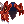{ loading=lazy } | Pedaço de Pele do Guardião [1] | 1 | 0,01% |
| { loading=lazy } | Lâmina Gêmea Azul [3] | 1 | 0,01% |
| { loading=lazy } | Lâmina Gêmea Vermelha [3] | 1 | 0,01% |
| 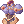{ loading=lazy } | Armadura das Valquírias [1] | 1 | 0,01% |
| 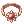{ loading=lazy } | Anel do Senhor das Chamas | 1 | 0,01% |
| 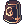{ loading=lazy } | Elmo do Abismo [1] | 1 | 0,01% |
| { loading=lazy } | Orelhas de Elfo [1] | 1 | 0,01% |
| 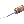{ loading=lazy } | Rondel [1] | 1 | 0,01% |
| 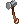{ loading=lazy } | Martelo de Refinar Carta | 1 | 0,01% |
| 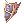{ loading=lazy } | Escudo da Valquíria [1] | 1 | 0,10% |
| 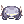{ loading=lazy } | Boina Alada | 1 | 0,10% |
| { loading=lazy } | Anel de Diabolus [1] | 1 | 0,10% |
| 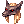{ loading=lazy } | Elmo de Anubis | 1 | 0,10% |
| { loading=lazy } | Rondel | 1 | 0,10% |
| 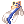{ loading=lazy } | Luvas de Orleans [1] | 1 | 0,10% |
| 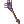{ loading=lazy } | Lança de Caça [1] | 1 | 0,10% |
| { loading=lazy } | Boneca de Alice [1] | 1 | 0,10% |
| 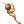{ loading=lazy } | Vara Sagrada [1] | 1 | 0,10% |
| 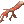{ loading=lazy } | Galho Sangrento | 1 | 0,10% |
| 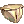{ loading=lazy } | Roupa de Baixo [1] | 1 | 0,10% |
| { loading=lazy } | Camiseta [1] | 1 | 0,10% |
| 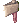{ loading=lazy } | Machado dos Orcs [4] | 1 | 0,10% |
| 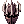{ loading=lazy } | Elmo de Diabolus [1] | 1 | 0,10% |
| { loading=lazy } | Espada Elemental [3] | 1 | 0,10% |
| { loading=lazy } | Máscara do Mason | 1 | 0,10% |
| { loading=lazy } | Chapéu de Lamen | 1 | 0,10% |
| { loading=lazy } | Asa de Mosca Ilimitada | 1 | 0,10% |
| { loading=lazy } | Goma de Mascar | 1 | 0,10% |
| { loading=lazy } | Grimório de Combate | 1 | 0,10% |
| { loading=lazy } | Manual de Classe 100% | 1 | 0,10% |
| 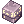{ loading=lazy } | Caixa de 10 Eluniums Enriquecidos | 1 | 0,10% |
| { loading=lazy } | Caixa de 10 Oridecons Enriquecidos | 1 | 0,10% |
| { loading=lazy } | Passe Antigravitacional | 1 | 0,10% |
| 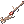{ loading=lazy } | Antique Pipe | 1 | 0,10% |
| 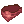{ loading=lazy } | Máscara de Fugitivo | 1 | 0,10% |
| { loading=lazy } | Máscara Colorida | 1 | 0,10% |
| 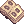{ loading=lazy } | Velho Álbum de Cartas | 1 | 0,10% |
| 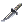{ loading=lazy } | Faca de Combate | 1 | 0,10% |
| 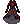{ loading=lazy } | Manto de Diabolus [1] | 1 | 0,10% |
| 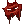{ loading=lazy } | Manteau de Diabolus [1] | 1 | 0,10% |
| 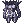{ loading=lazy } | Armadura de Diabolus [1] | 1 | 0,10% |
| 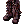{ loading=lazy } | Botas de Diabolus [1] | 1 | 0,10% |
| 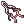{ loading=lazy } | Infiltrador [1] | 1 | 0,10% |
| 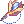{ loading=lazy } | Broche de Bradium [1] | 1 | 0,10% |
| { loading=lazy } | Brinco de Bradium [1] | 1 | 0,10% |
| 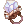{ loading=lazy } | Anel de Bradium [1] | 1 | 0,10% |
| { loading=lazy } | Escudo de Bradium [1] | 1 | 0,10% |
| 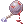{ loading=lazy } | Bola de Ferro Ensanguentada [1] | 1 | 0,10% |
| { loading=lazy } | Olhos Biônicos [1] | 1 | 0,10% |
| { loading=lazy } | Pergaminho de Refino de Arma +10 | 1 | 0,10% |
| { loading=lazy } | Pergaminho de Refino de Equipamento +10 | 1 | 0,10% |
| { loading=lazy } | Poção Azul | 20 | 0,92% |
| { loading=lazy } | Poção Branca Compacta | 30 | 0,92% |
| { loading=lazy } | Velho Álbum de Cartas | 1 | 0,92% |
| 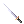{ loading=lazy } | +10 Kataná [4] | 1 | 0,92% |
| 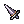{ loading=lazy } | Gladius [3] | 1 | 0,92% |
| { loading=lazy } | Infiltrador [1] | 1 | 0,92% |
| 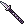{ loading=lazy } | +10 Pique [4] | 1 | 0,92% |
| 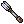{ loading=lazy } | +10 Maça [4] | 1 | 0,92% |
| 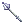{ loading=lazy } | Maça Longa | 1 | 0,92% |
| 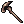{ loading=lazy } | +10 Bastão [4] | 1 | 0,92% |
| 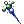{ loading=lazy } | Cajado Perfurador | 1 | 0,92% |
| 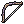{ loading=lazy } | +10 Arco Composto [4] | 1 | 0,92% |
| 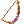{ loading=lazy } | Arco de Orc | 1 | 0,92% |
| { loading=lazy } | Escudo Espelhado [1] | 1 | 0,92% |
| 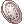{ loading=lazy } | Travessa de Orleans [1] | 1 | 0,92% |
| 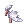{ loading=lazy } | Asas de Anjo | 1 | 0,92% |
| { loading=lazy } | Faixa de Fantasma | 1 | 0,92% |
| 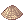{ loading=lazy } | Chapéu Chinês | 1 | 0,92% |
| 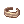{ loading=lazy } | Venda | 1 | 0,92% |
| 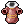{ loading=lazy } | Vestimenta Arcana [1] | 1 | 0,92% |
| 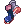{ loading=lazy } | Sapatos da Maré [1] | 1 | 0,92% |
| 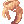{ loading=lazy } | Cachecol de Lã [1] | 1 | 0,92% |
| 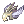{ loading=lazy } | Elmo Angelical | 1 | 0,92% |
| { loading=lazy } | Chapéu de Panda | 1 | 0,92% |
| 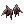{ loading=lazy } | Asas Malignas | 1 | 0,92% |
| { loading=lazy } | Orelhas de Anjo | 1 | 0,92% |
| 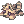{ loading=lazy } | Chapéu de Fumacento Dorminhoco | 1 | 0,92% |
| { loading=lazy } | Chapéu de Angeling | 1 | 0,92% |
| 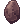{ loading=lazy } | Elunium Enriquecido | 1 | 0,92% |
| { loading=lazy } | Oridecon Enriquecido | 1 | 0,92% |
| { loading=lazy } | Caixa de 10 Símbolos de Siegfried | 1 | 0,92% |
| 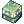{ loading=lazy } | Caixa de FOR +10 | 1 | 0,92% |
| { loading=lazy } | Caixa de AGI +10 | 1 | 0,92% |
| { loading=lazy } | Caixa de VIT +10 | 1 | 0,92% |
| { loading=lazy } | Caixa de INT +10 | 1 | 0,92% |
| { loading=lazy } | Caixa de DES +10 | 1 | 0,92% |
| { loading=lazy } | Caixa de SOR +10 | 1 | 0,92% |
| { loading=lazy } | Arco de Orc [3] | 1 | 1,00% |
| { loading=lazy } | Caixa de 400 Bandeiras | 1 | 1,00% |
| { loading=lazy } | Caixa de 200 Bandeiras | 1 | 1,50% |
| { loading=lazy } | Elunium | 1 | 1,62% |
| { loading=lazy } | Oridecon | 1 | 1,62% |
| { loading=lazy } | Bigorna de Emperium | 1 | 1,62% |
| { loading=lazy } | Natureza Grandiosa | 1 | 1,62% |
| { loading=lazy } | Coração Flamejante | 1 | 1,62% |
| { loading=lazy } | Vento Bruto | 1 | 1,62% |
| { loading=lazy } | Gelo Místico | 1 | 1,62% |
| { loading=lazy } | Karvodailnirol | 5 | 1,62% |
| { loading=lazy } | Detrimindexta | 5 | 1,62% |
| { loading=lazy } | Grande Laço [1] | 1 | 1,62% |
| { loading=lazy } | Bao-Bao | 1 | 1,62% |
| { loading=lazy } | Frigideira Lunar [4] | 1 | 1,63% |
| { loading=lazy } | Broquel de Pedra [1] | 1 | 1,63% |
| { loading=lazy } | Chapéu de Ulle [1] | 1 | 1,63% |
| { loading=lazy } | Chapéu de Gatinho Dorminhoco | 1 | 1,63% |
| { loading=lazy } | Caixa de Comidas +10 | 1 | 1,63% |
| { loading=lazy } | Caixa de Elunium | 1 | 1,63% |
| { loading=lazy } | Caixa de Oridecon | 1 | 1,63% |
| { loading=lazy } | Anel [1] | 1 | 1,63% |
| { loading=lazy } | Colar [1] | 1 | 1,63% |
| { loading=lazy } | Luva [1] | 1 | 1,63% |
| { loading=lazy } | Brinco [1] | 1 | 1,63% |
| { loading=lazy } | Broche [1] | 1 | 1,63% |
| { loading=lazy } | Rosário [1] | 1 | 1,63% |
| { loading=lazy } | Anel de Defesa | 1 | 1,63% |
| { loading=lazy } | Muramasa | 1 | 1,63% |
| { loading=lazy } | Batina [1] | 1 | 1,63% |
| { loading=lazy } | Proteção Angelical [1] | 1 | 1,63% |
| { loading=lazy } | Asa de Águia [1] | 1 | 1,63% |
| { loading=lazy } | Escudo de Escamas de Naga [1] | 1 | 2,00% |
| { loading=lazy } | Caixa de 100 Bandeiras | 1 | 2,00% |
| { loading=lazy } | Caixa de 50 Bandeiras | 1 | 3,00% |
| { loading=lazy } | Caixa de 20 Bandeiras | 1 | 4,00% |

## :gem: Caixa Misteriosa Rara

Gerente de Moedas Douradas (700 Moedas Douradas), Trocador de Bandeiras (5.000 Bandeiras), Torre MVP, Arena Lothus e Campeão MVP do Mês.

| | Prêmio | Qtd. | Chance |
|---|---|---|---|
| { loading=lazy } | Caixa Lendária de Armamento | 1 | 0,10% |
| { loading=lazy } | Rosa Romântica [2] | 1 | 0,40% |
| { loading=lazy } | Elmo de Valkyria Ying Yang [1] | 1 | 0,40% |
| { loading=lazy } | Elmo de Valkyria Branco [1] | 1 | 0,40% |
| { loading=lazy } | Elmo de Valkyria Azul [1] | 1 | 0,40% |
| { loading=lazy } | Elmo de Valkyria Preto [1] | 1 | 0,40% |
| { loading=lazy } | Elmo da Valkyria Marrom [1] | 1 | 0,40% |
| { loading=lazy } | Óculos Amorzinho [2] | 1 | 0,40% |
| { loading=lazy } | Sleipnir [1] | 1 | 0,40% |
| { loading=lazy } | Brisingamen [1] | 1 | 0,40% |
| { loading=lazy } | Chapéu do Porquinho [1] | 1 | 0,40% |
| { loading=lazy } | Chapéu do Ratinho [1] | 1 | 0,40% |
| { loading=lazy } | Chapéu do Tigrinho [1] | 1 | 0,40% |
| { loading=lazy } | Chapéu de Bebê Dragão [1] | 1 | 0,40% |
| { loading=lazy } | Rondel [1] | 1 | 0,40% |
| { loading=lazy } | Sapatos Divergentes | 1 | 0,40% |
| { loading=lazy } | Escudo da Valquíria [1] | 1 | 0,40% |
| { loading=lazy } | Anel de Diabolus [1] | 1 | 0,40% |
| { loading=lazy } | Manto de Diabolus [1] | 1 | 0,40% |
| { loading=lazy } | Manteau de Diabolus [1] | 1 | 0,40% |
| { loading=lazy } | Botas de Diabolus [1] | 1 | 0,40% |
| { loading=lazy } | Armadura das Valquírias [1] | 1 | 0,40% |
| { loading=lazy } | Manto das Valquírias [1] | 1 | 0,40% |
| { loading=lazy } | Sapatos das Valquírias [1] | 1 | 0,40% |
| { loading=lazy } | Faca de Combate | 1 | 0,40% |
| { loading=lazy } | Cajado do Feiticeiro [2] | 1 | 0,40% |
| { loading=lazy } | Cajado Perfurador | 1 | 0,40% |
| { loading=lazy } | Boina Alada | 1 | 0,40% |
|  | Par de acessórios de Ifrit (Anel e Brinco) | 1 | 0,40% |
| { loading=lazy } | Luvas de Orleans [1] | 1 | 0,40% |
| { loading=lazy } | Manteau do Capitão [1] | 1 | 0,40% |
| { loading=lazy } | Armadura de Diabolus [1] | 1 | 0,40% |
|  | Lâmina Gêmea de Naght Sieger (azul ou vermelha) | 1 | 0,40% |
| { loading=lazy } | Bastão da Destruição [1] | 1 | 0,40% |
|  | Bastão e Capa do Sobrevivente | 1 | 0,40% |
| { loading=lazy } | Óculos Escuros [2] | 1 | 0,40% |
| { loading=lazy } | Orelhas de Elfo [1] | 1 | 0,40% |
| { loading=lazy } | Pedaço de Pele do Guardião [1] | 1 | 0,40% |
| { loading=lazy } | Visual da Fortuna | 1 | 0,50% |
| { loading=lazy } | Martelo de Refinar Carta | 1 | 0,50% |
| { loading=lazy } | Álbum de Cartas Lendário | 1 | 1,00% |
| { loading=lazy } | Bola de Ferro Ensanguentada [1] | 1 | 1,00% |
| { loading=lazy } | Pergaminho de Refino de Arma +10 | 1 | 1,00% |
| { loading=lazy } | Pergaminho de Refino de Equipamento +10 | 1 | 1,00% |
| { loading=lazy } | Cupom de Cor Infinito | 1 | 1,00% |
| { loading=lazy } | Anel [1] | 1 | 1,50% |
| { loading=lazy } | Luva [1] | 1 | 1,50% |
| { loading=lazy } | Chapéu de Ulle [1] | 1 | 1,50% |
| { loading=lazy } | Asa de Mosca Ilimitada | 1 | 1,50% |
| { loading=lazy } | Caixa de 400 Bandeiras | 1 | 2,00% |
| { loading=lazy } | Caixa do Poder Máximo | 1 | 2,00% |
| { loading=lazy } | Enciclopédia de Combate | 1 | 3,00% |
| { loading=lazy } | Chicle de Bola | 1 | 3,00% |
| { loading=lazy } | Manual de Classe 200% | 1 | 3,00% |
| { loading=lazy } | Caixa de FOR +10 | 1 | 3,50% |
| { loading=lazy } | Caixa de AGI +10 | 1 | 3,50% |
| { loading=lazy } | Caixa de VIT +10 | 1 | 3,50% |
| { loading=lazy } | Caixa de INT +10 | 1 | 3,50% |
| { loading=lazy } | Caixa de DES +10 | 1 | 3,50% |
| { loading=lazy } | Caixa de SOR +10 | 1 | 3,50% |
| { loading=lazy } | Manual de Combate 300% | 1 | 4,00% |
| { loading=lazy } | Goma de Mascar 250% | 1 | 4,00% |
| { loading=lazy } | Velho Álbum de Cartas | 1 | 4,50% |
| { loading=lazy } | Caixa de Fruto de Yggdrasil[10] | 1 | 4,50% |
| { loading=lazy } | Caixa Misteriosa | 10 | 5,00% |
| { loading=lazy } | Moeda de Loki | 50 | 5,00% |
| { loading=lazy } | Caixa de Poções Azuis | 10 | 5,20% |
| { loading=lazy } | Bandeira Nacional | 200 | 6,90% |

## :egg: Ovo Misterioso

Dá o ovo de um destes pets (mesma chance para todos). O pet já nasce com lealdade máxima.

| | Ovo | Chance |
|---|---|---|
| { loading=lazy } | Ovo de Poring | 1,49% |
| { loading=lazy } | Ovo de Drops | 1,49% |
| { loading=lazy } | Ovo de Poporing | 1,49% |
| { loading=lazy } | Ovo de Lunático | 1,49% |
| { loading=lazy } | Ovo de Picky | 1,49% |
| { loading=lazy } | Ovo de Chonchon | 1,49% |
| { loading=lazy } | Ovo de Chonchon de Aço | 1,49% |
| { loading=lazy } | Ovo de Mosca Caçadora | 1,49% |
| { loading=lazy } | Ovo de Bebê Selvagem | 1,49% |
| { loading=lazy } | Ovo de Lobo do Deserto Bebê | 1,49% |
| { loading=lazy } | Ovo de Rocker | 1,49% |
| { loading=lazy } | Ovo de Esporo | 1,49% |
| { loading=lazy } | Ovo de Esporo Venenoso | 1,49% |
| { loading=lazy } | Ovo de PecoPeco | 1,49% |
| { loading=lazy } | Ovo de Fumacento | 1,49% |
| { loading=lazy } | Ovo de Yoyo | 1,49% |
| { loading=lazy } | Ovo de Guerreiro Orc | 1,49% |
| { loading=lazy } | Ovo de Munak | 1,49% |
| { loading=lazy } | Ovo de Dokebi | 1,49% |
| { loading=lazy } | Ovo de Sohee | 1,49% |
| { loading=lazy } | Ovo de Ísis | 1,49% |
| { loading=lazy } | Ovo de Petite Verde | 1,49% |
| { loading=lazy } | Ovo de Deviruchi | 1,49% |
| { loading=lazy } | Ovo de Bafomé Jr. | 1,49% |
| { loading=lazy } | Ovo de Bongun | 1,49% |
| { loading=lazy } | Ovo de Jirtas | 1,49% |
| { loading=lazy } | Ovo de Alice | 1,49% |
| { loading=lazy } | Ovo de Mascote Buzzy Brother | 1,49% |
| { loading=lazy } | Ovo de Goblin Natalino | 1,49% |
| { loading=lazy } | Ovo de Donzela Verde | 1,49% |
| { loading=lazy } | Ovo de Coelho | 1,49% |
| { loading=lazy } | Ovo de Goblin (Adaga) | 1,49% |
| { loading=lazy } | Ovo de Goblin (Mangual) | 1,49% |
| { loading=lazy } | Ovo de Goblin (Martelo) | 1,49% |
| { loading=lazy } | Ovo de Deletério | 1,49% |
| { loading=lazy } | Ovo de Diabolik | 1,49% |
| { loading=lazy } | Ovo de Andarilho | 1,49% |
| { loading=lazy } | Ovo de Boneco de Ano Novo | 1,49% |
| { loading=lazy } | Ovo de Golem | 1,49% |
| { loading=lazy } | Ovo de Marionette | 1,49% |
| { loading=lazy } | Ovo de Medusa | 1,49% |
| { loading=lazy } | Ovo de Sussurro | 1,49% |
| { loading=lazy } | Ovo de Líder Goblin | 1,49% |
| { loading=lazy } | Ovo de Succubus | 1,49% |
| { loading=lazy } | Ovo de Incubus | 1,49% |
| { loading=lazy } | Ovo de Pesadelo | 1,49% |
| { loading=lazy } | Ovo de Shinobi | 1,49% |
| { loading=lazy } | Ovo de Miyabi Ningyo | 1,49% |
| { loading=lazy } | Ovo de Ninfa Perversa | 1,49% |
| { loading=lazy } | Ovo do Atirador de Pedras | 1,49% |
| { loading=lazy } | Ovo de Dullahan | 1,49% |
| { loading=lazy } | Ovo de Loli Ruri | 1,49% |
| { loading=lazy } | Ovo de Mao Guai | 1,49% |
| { loading=lazy } | Ovo de Gato de Folha | 1,49% |
| { loading=lazy } | Bacsojin Egg | 1,49% |
| { loading=lazy } | Ovo de Imp | 1,49% |
| { loading=lazy } | Ovo de Nove Caudas | 1,49% |
| { loading=lazy } | Ovo de Ursinho | 1,49% |
| { loading=lazy } | Ovo de Gremlin | 1,49% |
| { loading=lazy } | Ovo de Múmia | 1,49% |
| { loading=lazy } | Ovo de Salgueiro | 1,49% |
| { loading=lazy } | Ovo de Roween | 1,49% |
| { loading=lazy } | Ovo de Sacerdote Maldito | 1,49% |
| { loading=lazy } | Ovo de Familiar | 1,49% |
| { loading=lazy } | Ovo de Tikbalang | 1,49% |
| { loading=lazy } | Ovo de Bebê Poring | 1,49% |
| { loading=lazy } | Ovo de Mini Beta | 1,49% |

## :hatching_chick: Ovo Lendário

Dá o ovo de um destes pets evoluídos (mesma chance para todos). O pet já nasce com lealdade máxima.

| | Ovo | Chance |
|---|---|---|
| { loading=lazy } | Ovo de Mastering | 6,25% |
| { loading=lazy } | Ovo de Metaller | 6,25% |
| { loading=lazy } | Ovo de Angeling | 6,25% |
| { loading=lazy } | Ovo de Savage | 6,25% |
| { loading=lazy } | Ovo de Grand Orc | 6,25% |
| { loading=lazy } | Ovo de Choco | 6,25% |
| { loading=lazy } | Ovo de Múmia Anciã | 6,25% |
| { loading=lazy } | Ovo de Ammut | 6,25% |
| { loading=lazy } | Ovo de Gato de Nove Caudas | 6,25% |
| { loading=lazy } | Ovo de Grand Peco | 6,25% |
| { loading=lazy } | Ovo de Hyegun | 6,25% |
| { loading=lazy } | Ovo de Hodremlin | 6,25% |
| { loading=lazy } | Ovo de Aliot | 6,25% |
| { loading=lazy } | Ovo de Alicel | 6,25% |
| { loading=lazy } | Ovo de Aliza | 6,25% |
| { loading=lazy } | Ovo de Lobo do Deserto | 6,25% |

## :flower_playing_cards: Álbum de Cartas Lendário

30% de chance de uma carta de MVP e 70% de miniboss. Dentro de cada grupo, todas têm a mesma chance. Sai um aviso para o servidor inteiro.

| | Carta de MVP | Chance |
|---|---|---|
| { loading=lazy } | Carta Freeoni | 0,77% |
| { loading=lazy } | Carta Eddga | 0,77% |
| { loading=lazy } | Carta Besouro-Ladrão Dourado | 0,77% |
| { loading=lazy } | Carta Flor do Luar | 0,77% |
| { loading=lazy } | Carta Abelha-Rainha | 0,77% |
| { loading=lazy } | Carta Drácula | 0,77% |
| { loading=lazy } | Carta Senhor dos Orcs | 0,77% |
| { loading=lazy } | Carta Drake | 0,77% |
| { loading=lazy } | Carta Doppelganger | 0,77% |
| { loading=lazy } | Carta Orc Herói | 0,77% |
| { loading=lazy } | Carta Osíris | 0,77% |
| { loading=lazy } | Carta Maya | 0,77% |
| { loading=lazy } | Carta Bafomé | 0,77% |
| { loading=lazy } | Carta Faraó | 0,77% |
| { loading=lazy } | Carta Senhor das Trevas | 0,77% |
| { loading=lazy } | Carta Amon-Ra | 0,77% |
| { loading=lazy } | Carta Samurai Encarnado | 0,77% |
| { loading=lazy } | Carta Senhor dos Mortos | 0,77% |
| { loading=lazy } | Carta Tao Gunka | 0,77% |
| { loading=lazy } | Carta General Tartaruga | 0,77% |
| { loading=lazy } | Carta Cavaleiro da Tempestade | 0,77% |
| { loading=lazy } | Carta Hatii | 0,77% |
| { loading=lazy } | Carta Serpente Suprema | 0,77% |
| { loading=lazy } | Carta RSX-0806 | 0,77% |
| { loading=lazy } | Carta Espadachim Egnigem | 0,77% |
| { loading=lazy } | Carta Algoz Eremes | 0,77% |
| { loading=lazy } | Carta Mestre Ferreiro Howard | 0,77% |
| { loading=lazy } | Carta Lady Branca | 0,77% |
| { loading=lazy } | Carta Vesper | 0,77% |
| { loading=lazy } | Carta Lady Tanee | 0,77% |
| { loading=lazy } | Carta Detardeurus | 0,77% |
| { loading=lazy } | Carta Memória de Thanatos | 0,77% |
| { loading=lazy } | Carta Kiel-D-01 | 0,77% |
| { loading=lazy } | Carta Valkyrie Randgris | 0,77% |
| { loading=lazy } | Carta Pesar Noturno | 0,77% |
| { loading=lazy } | Carta Ktullanux | 0,77% |
| { loading=lazy } | Carta Atroce | 0,77% |
| { loading=lazy } | Carta Ifrit | 0,77% |
| { loading=lazy } | Carta Bispo Decadente | 0,77% |

| | Carta de miniboss | Chance |
|---|---|---|
| { loading=lazy } | Carta Ghostring | 1,79% |
| { loading=lazy } | Carta Angeling | 1,79% |
| { loading=lazy } | Carta Grifo | 1,79% |
| { loading=lazy } | Carta Ilusão das Trevas | 1,79% |
| { loading=lazy } | Carta Sacerdote Maldito | 1,79% |
| { loading=lazy } | Carta Deviling | 1,79% |
| { loading=lazy } | Carta Libélula | 1,79% |
| { loading=lazy } | Carta Lobo Errante | 1,79% |
| { loading=lazy } | Carta Mastering | 1,79% |
| { loading=lazy } | Carta Maya Macho | 1,79% |
| { loading=lazy } | Carta Dragão Mutante | 1,79% |
| { loading=lazy } | Carta Mysteltainn | 1,79% |
| { loading=lazy } | Carta Duque Coruja | 1,79% |
| { loading=lazy } | Carta Barão Coruja | 1,79% |
| { loading=lazy } | Carta ArchAngeling | 1,79% |
| { loading=lazy } | Carta Executor | 1,79% |
| { loading=lazy } | Carta Tirfing | 1,79% |
| { loading=lazy } | Carta Eclipse | 1,79% |
| { loading=lazy } | Carta Gato de Nove Caudas | 1,79% |
| { loading=lazy } | Carta Quimera | 1,79% |
| { loading=lazy } | Carta Sapo-Cururu | 1,79% |
| { loading=lazy } | Carta Gemini-S58 | 1,79% |
| { loading=lazy } | Carta Hydrolancer | 1,79% |
| { loading=lazy } | Carta Baronesa da Retribuição | 1,79% |
| { loading=lazy } | Carta Dama da Guarda | 1,79% |
| { loading=lazy } | Carta Senhora do Abrigo | 1,79% |
| { loading=lazy } | Carta Senhora do Conforto | 1,79% |
| { loading=lazy } | Carta Maero de Thanatos | 1,79% |
| { loading=lazy } | Carta Odium de Thanatos | 1,79% |
| { loading=lazy } | Carta Despero de Thanatos | 1,79% |
| { loading=lazy } | Carta Pesar de Thanatos | 1,79% |
| { loading=lazy } | Carta Skeggiold | 1,79% |
| { loading=lazy } | Carta Galion | 1,79% |
| { loading=lazy } | Carta Byorgue | 1,79% |
| { loading=lazy } | Carta Espadachim Guardião | 1,79% |
| { loading=lazy } | Carta Arqueiro Guardião | 1,79% |
| { loading=lazy } | Carta Salamandra | 1,79% |
| { loading=lazy } | Carta Kasa | 1,79% |
| { loading=lazy } | Carta Necromante | 1,79% |

## :card_index: Velho Álbum de Cartas

Dá uma carta aleatória da lista oficial do álbum (quase todas as cartas do jogo, as de MVP são bem mais raras). O servidor inteiro fica sabendo qual carta saiu.

