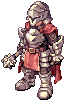

# :triangular_flag_on_post: Facções

O servidor tem duas facções: a **Facção Vermelha** e a **Facção Azul**. Elas disputam pontos toda semana, um prêmio todo mês e a **Guerra de Facção**.

## Escolher a facção

- Quem ainda não tem facção recebe a janela de escolha ao entrar no jogo (pode deixar para depois).
- Também dá para escolher com `@faccao` ou no NPC { loading=lazy } **Facções**, na [Central do Aventureiro](../npcs/central-aventureiro.md) (68,52).
- A facção vale para **todos os personagens da conta**.
- O nome da facção aparece junto com o seu nome (título **Facção Vermelha** ou **Facção Azul**).
- **Equilíbrio:** se uma facção tiver bem mais membros ativos que a outra (5 ou mais e 20% a mais), quem escolhe agora só pode entrar na menor.
- **Trocar de facção:** só do **dia 1 ao dia 3** de cada mês, 1 vez por mês. Os pontos que você já fez ficam com a facção antiga.

## Pontos da semana

A semana vai de segunda a domingo. Tudo o que você faz conta para a sua facção:

| Como | Pontos |
|---|---|
| MVP derrotado | 10 |
| A cada 50 monstros | 1 (até 20 por dia) |
| Vitória no [Ranking PvP](../eventos/arena-pvp.md#ranking-pvp) ou na Copa Lothus | 5 |
| Abate de alguém da outra facção na Arena PvP livre | 2 (até 40 por dia; mesmo IP não conta) |
| Vitória no [Pique-gema 3x3](../eventos/pique-gema.md) | 5 |
| Guerra de Facção | 1 por abate; 200 para a facção vencedora |

## Prêmios

- **Semana:** na segunda-feira, a facção com mais pontos vence a semana e **todos dela ganham +10% de EXP e de drop** até domingo.
- **Mês:** no dia 1, a facção que venceu mais semanas no mês (a Guerra de Facção vale 2) vence o mês. Empate: vence quem fez mais pontos no mês.
  Quem dela fez **100 pontos ou mais** no mês recebe pelo correio **1 Caixa Misteriosa Rara, 30 Moedas Douradas e 100 Bandeiras**.

Veja os pontos da semana, o ranking de cada facção e as semanas vencidas no mês com `@faccao`.

## Guerra de Facção

- **Quando:** na **última sexta-feira do mês, às 21h** (nesse dia não tem o Pique-pega das 21h). Inscrição nos 5 minutos antes, com `@evento`. Precisa ter facção; um personagem por conta.
- **Onde:** a arena da Batalha de Krieger, só para a guerra. A Vermelha começa a noroeste e a Azul a sudeste, com o emblema da facção em cima da cabeça.
- **Como:** 15 minutos. Cada abate vale 1 ponto para a facção (o placar aparece na tela); quem cai volta à base em 5 segundos. Vence a facção com mais abates.
- **Facção com menos gente:** +25% de HP e de dano (se tiver menos de 80% da outra) ou +50% (se tiver menos da metade).
- **Prêmios:** vitória 100 Bandeiras + 60 Moedas de Loki + 20 Moedas Douradas; derrota 30 Bandeiras + 20 Moedas de Loki; empate 50 Bandeiras + 30 Moedas de Loki. Cada abate dá 2 Bandeiras na hora.
- A facção vencedora ganha **200 pontos** na semana e a vitória vale **2 semanas** na disputa do mês.
