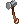

# :hammer: Mestre Ferreiro e refino

## Mestre Ferreiro (Blackroom 112,88)

Junte os ingredientes e ele forja:

| Item | Bandeiras | Moedas de Loki | Outros |
|---|---|---|---|
| **Elunium Enriquecido** | 100 | 80 | 5 Elunium, 1 Ouro |
| **Oridecon Enriquecido** | 200 | 150 | 5 Oridecon, 2 Ouro |
| **5 Bênçãos do Ferreiro** (de uma vez) | 500 | 200 | 1 Oridecon Enriquecido, 1 Elunium Enriquecido, 5 Ouro, 120 Fragmentos Estelares |

O NPC mostra em verde o que você já tem e em vermelho o que falta, com os nomes dos itens em português. Quem forja as Bênçãos do Ferreiro é anunciado no servidor.

A Bênção do Ferreiro e os minérios enriquecidos também estão na [Loja de Pontos de Missão](missoes.md#loja-de-pontos-de-missao).

## Pergaminhos de Refino +10

Deixam uma arma ou um equipamento em +10 sem risco. Veja em [Caixas e ovos](caixas-e-ovos.md#pergaminhos-de-refino-10).

## Bênção do Ferreiro

- **No refinador:** num refino com risco de quebrar, o refinador pergunta se você quer usar 1 Bênção do Ferreiro.
  Se o refino falhar, o equipamento **não quebra** e continua com o mesmo refino.
- **Onde cai:** Howard Alt-Eisen do Biolab, com chance fixa (não muda com as rates):

| Howard | Chance |
|---|---|
| Comum (Biolab) | 0,3% |
| Miniboss (escolta do MVP do Biolab) | 3% |
| MVP (Whitesmith Howard) | 30% |

## Refino das cartas (+1 a +10)

Um **Ferreiro** ou **Mestre-Ferreiro** refina as **cartas de um equipamento** na **Forja Lendária**
([Central do Aventureiro](../npcs/central-aventureiro.md) 55,54), opção "Refinar as cartas de um equipamento".

- O refino fica **no equipamento**: aparece na descrição dele como **Refino das cartas +N**.
- Cada nível dá **+10%** nos bônus das cartas encaixadas nele: atributos, ATK, DEF, HP/SP, dano e resistência por raça, elemento e tamanho, chances de efeito e de magia automática, drops e outros.
  Exemplo: uma carta com +10 de ATK dá +11 no +1, +15 no +5 e +20 no +10.
- Bônus negativos e bônus de conjunto de cartas não mudam. Valores pequenos arredondam (+1 FOR só vira +2 no +5).
- Tirar a carta na Removedora **não tira** o refino: a carta nova que você encaixar também ganha o bônus.
- Cada tentativa custa 1  **Martelo de Refinar Carta** + 500.000z.
- O equipamento e as cartas **nunca quebram**. Do **+5 em diante**, falhar faz as cartas voltarem 1 nível.
- Do +7 em diante, o sucesso é anunciado no servidor.
- Não é Ferreiro? Entregue o equipamento por troca a um Ferreiro de confiança (ele precisa estar no inventário de quem refina).

| Nível | Chance | Mestre-Ferreiro | Se falhar |
|---|---|---|---|
| +1 | 100% | 100% | perde o Martelo |
| +2 | 90% | 95% | perde o Martelo |
| +3 | 80% | 85% | perde o Martelo |
| +4 | 70% | 75% | perde o Martelo |
| +5 | 60% | 65% | perde o Martelo |
| +6 | 50% | 55% | volta para +4 |
| +7 | 40% | 45% | volta para +5 |
| +8 | 30% | 35% | volta para +6 |
| +9 | 20% | 25% | volta para +7 |
| +10 | 10% | 15% | volta para +8 |

**De onde vem o Martelo:** Visual da Fortuna (0,01% por monstro), Caixas Misteriosas, [Passe de Batalha](passe-batalha.md) e prêmios do [Ranking PvP](../eventos/arena-pvp.md#ranking-pvp).
