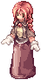

# :card_index: Galeria de Cartas

A **Galeria de Cartas** é o álbum de cartas da sua conta. Toda carta que você consegue entra no álbum
**para sempre**: basta ter a carta uma vez. Se depois você vender, trocar ou usar a carta, ela continua no álbum.

Abra o álbum em qualquer lugar com **`@galeria`** ou fale com a **Curadora da Galeria** na
[Central do Aventureiro](../npcs/central-aventureiro.md) (65,54).

{ loading=lazy }

## Como uma carta entra no álbum

Vale qualquer jeito de conseguir a carta:

- drop de monstro;
- compra em loja de NPC ou de jogador;
- troca com outro jogador, correio ou caixas;
- tirar do armazém ou do carrinho;
- equipamento com a carta encaixada.

Na **primeira vez** que você abre a Galeria, entram também as cartas que a sua conta já tinha: no inventário,
no carrinho e no armazém de todos os personagens, inclusive as encaixadas nos equipamentos.

Quando uma carta nova entra, aparece no chat o nome dela e como ficaram as categorias dela (por exemplo,
"Terra I 12/25").

## Categorias

São **437 cartas** em **22 categorias** de até 25 cartas. Só entram cartas de monstros que aparecem nos mapas.

- **Elementos:** por elemento do monstro (Neutro, Água, Terra, Fogo, Vento, Veneno, Sagrado e Fantasma,
  Sombrio, Morto-Vivo). Os elementos com muitas cartas são divididos em partes (I, II, III) pelo nível do monstro.
- **Cartas Raras:** as 25 cartas de monstros que quase não aparecem nos mapas.
- **Chefes:** cartas dos chefes (miniboss), em 2 partes.
- **MVPs:** cartas dos MVPs, em 2 partes.

Uma carta pode contar em mais de uma categoria: uma carta de chefe de fogo conta só em Chefes, mas uma carta
rara de Terra conta em Terra e em Cartas Raras.

A lista completa, com todas as cartas de cada categoria, está em [Categorias da Galeria](galeria-categorias.md).

## Prêmios: Fichas da Galeria

 Ao completar uma categoria você resgata **Fichas da Galeria** pelo álbum
(opção "Resgatar"). Quanto mais rara a categoria, mais fichas:

| Categoria | Fichas |
|---|---|
| Elementos | 5 a 10 (mais nas partes de monstros de nível alto) |
| Cartas Raras | 25 |
| Chefes I / Chefes II | 20 / 25 |
| MVPs I / MVPs II | 35 / 45 |

Quem completa Cartas Raras, Chefes ou MVPs é anunciado no servidor.

### Nível da Galeria

Você sobe **1 nível a cada 10 cartas** diferentes no álbum. A cada **5 níveis** (50 cartas) ganha
**3 Fichas**. Quem completar **o álbum inteiro** ganha mais **50 Fichas** e é anunciado no servidor.

## Loja de Fichas (Curadora da Galeria)

| Item | Fichas |
|---|---|
| Caixa Misteriosa | 3 |
| Velho Álbum de Cartas | 6 |
| Caixa de 100 Bandeiras | 8 |
| Bênção do Ferreiro | 12 |
| Caixa Misteriosa Rara | 20 |
| Álbum de Cartas Lendário | 35 |
| Ovo Lendário | 40 |
| Cupom de Cor Infinito | 45 |
| Pergaminho de Refino de Arma +10 | 60 |
| Pergaminho de Refino de Equipamento +10 | 60 |
| Visual da Fortuna | 150 |

As Fichas da Galeria podem ser trocadas entre jogadores e vendidas em loja de jogador.
