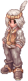
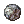
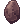
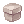

# :scroll: Missões

## Hobota: Missões de Caça

{ align=right loading=lazy }

O Hobota fica na [Central do Aventureiro](../npcs/central-aventureiro.md). Cada missão pede **3 monstros** sorteados. **Não tem prazo** para terminar.

| Dificuldade | Nível mínimo | Abates de cada monstro | Zeny | Pontos de Missão |
|---|---|---|---|---|
| Iniciante | 1 | 100 | 100.000 | 1 |
| Intermediário | 41 | 150 | 300.000 | 2 |
| Avançado | 71 | 200 | 800.000 | 3 |
| Elite | 91 | 250 | 1.500.000 | 5 |

- **Antes de aceitar**, o Hobota mostra os 3 monstros e o prêmio completo: EXP de base, EXP de classe, zeny e Pontos de Missão. A EXP é a mesma de todos os monstros pedidos somados (ex.: 100 Porings = a EXP de 100 Porings).
- Depois de aceitar, as 3 caças ficam no seu **diário de missões**, no canto direito da tela, com a contagem de cada monstro. Quando as 3 estiverem completas, volte ao Hobota para entregar.
- **Uma missão a cada 8 horas por conta**, em um personagem por vez.
- **Em grupo:** o líder pega a missão e todo o grupo (online, perto dele e sem outra missão) recebe a mesma. Abates de membros do grupo na mesma tela contam para todos. Sair do grupo não cancela a missão.
- **Bônus de grupo:** +1 Ponto de Missão a cada 2 membros.
- **Desistir:** 50.000z (solo) ou 100.000z (grupo). Depois de desistir dá para pegar outra na hora.

### Loja de Pontos de Missão

| Prêmio | Pontos |
|---|---|
|  Elunium | 1 |
|  Oridecon | 1 |
|  Elunium Enriquecido | 6 |
|  Oridecon Enriquecido | 8 |
|  Bênção do Ferreiro | 15 |
|  Caixa Misteriosa | 2 |
|  Goma de Mascar | 3 |
|  Grimório de Combate | 2 |
|  Manual de Classe 100% | 2 |
|  Caixa Misteriosa Rara | 40 |

## Quadro de Missões

O Quadro de Missões fica na [Central do Aventureiro](../npcs/central-aventureiro.md). As missões podem ser repetidas **quantas vezes você quiser**.
A EXP de cada missão aparece na lista do Quadro, antes de você escolher.

### Entregas

Traga todos os itens de uma vez.

| Itens | Nível | EXP de base | EXP de classe |
|---|---|---|---|
| 25 Felpa | 2 a 20 | 770 | 60 |
| 25 Crisálida | 2 a 20 | 770 | 60 |
| 25 Bico de Ave | 10 a 30 | 8.000 | 4.000 |
| 25 Pó de Borboleta | 15 a 45 | 5.900 | 2.250 |
| 25 Avelã | 18 a 60 | 7.200 | 7.810 |
| 25 Espinho de Porco-Espinho | 24 a 60 | 20.850 | 12.544 |
| 25 Coração de Pedra | 25 a 60 | 28.000 | 18.000 |
| 25 Pele de Minhoca | 25 a 60 | 39.438 | 28.120 |
| 25 Brasão | 30 a 65 | 60.000 | 46.000 |
| 50 Chifre de Dokebi | 35 a 70 | 84.000 | 72.000 |
| 50 Folha Gigante | 36 a 65 | 51.480 | 63.024 |
| 20 Pele de Anolian | 45 a 80 | 137.900 | 86.600 |
| 50 Bactérias | 60 a 74 | 500.532 | 288.904 |
| 50 Folha Afiada | 60 a 85 | 524.970 | 283.670 |
| 50 Chifre de Bode | 70 a 85 | 516.978 | 310.310 |

### Caças

Escolha o monstro e a quantidade: **50, 100 ou 150**. A EXP abaixo é para 50; 100 dá o dobro e 150 o triplo. Abates do seu grupo no mesmo mapa e na mesma tela contam.

| Monstro | Nível | EXP de base (50) | EXP de classe (50) |
|---|---|---|---|
| Fabre | 2 a 20 | 770 | 60 |
| Pupa | 2 a 20 | 770 | 60 |
| Peco Peco | 10 a 30 | 8.000 | 4.000 |
| Creamy | 15 a 45 | 5.900 | 2.250 |
| Coco | 18 a 60 | 7.200 | 7.810 |
| Caramel | 24 a 60 | 20.850 | 12.544 |
| Golem | 25 a 60 | 28.000 | 18.000 |
| Hode | 25 a 60 | 31.550 | 22.500 |
| Frilldora | 30 a 65 | 60.000 | 46.000 |
| Dokebi | 35 a 70 | 84.000 | 72.000 |
| Leaf Cat | 36 a 65 | 51.480 | 63.024 |
| Alligator | 45 a 80 | 137.900 | 86.600 |
| Remover | 45 a 80 | 550.000 | 340.000 |
| Demon Pungus | 60 a 74 | 500.532 | 288.904 |
| Dryad | 60 a 85 | 524.970 | 283.670 |
| Assaulter | 60 a 85 | 850.000 | 550.000 |
| Goat | 70 a 85 | 1.033.956 | 620.620 |
| Ice Titan | 70 a 95 | 3.640.000 | 2.600.000 |
| Succubus | 70 a 98 | 5.300.000 | 3.800.000 |
| Deleter | 75 a 97 | 1.550.936 | 930.932 |
| Lava Golem | 75 a 97 | 1.939.200 | 1.162.800 |
| Medusa | 75 a 97 | 2.062.800 | 1.409.100 |
| Acidus | 75 a 97 | 2.570.000 | 1.630.000 |
| Draco | 75 a 98 | 3.700.000 | 2.800.000 |
| Salamander | 75 a 98 | 8.600.000 | 6.200.000 |

## :star: EXP x5 nas missões da Ilha sem Nome e de Rachel

As missões oficiais da **Ilha sem Nome** (a história que abre a Abadia Amaldiçoada, e a troca das joias
amaldiçoadas com o Soldado Aposentado em Prontera) e de **Rachel** (Arunafeltz e o Santuário) dão **5 vezes mais EXP**
que o normal. É um ótimo caminho para subir do nível 65 ao 99.

