# :bellhop_bell: Serviços

Uns ficam em [Prontera](../npcs/prontera.md) (Banqueiro e Cambista do Bilhão), o Gerente de Builds fica na [Sala VIP](../npcs/sala-vip.md) e outros na [Central do Aventureiro](../npcs/central-aventureiro.md) (entrada pelo NPC Central do Aventureiro em Prontera, 164,178).

## Estilista

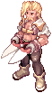{ align=right loading=lazy }

Fica na [Central do Aventureiro](../npcs/central-aventureiro.md) e na [Sala VIP](../npcs/sala-vip.md). Abre a janela de visual do jogo.

- **Cabelo e cor do cabelo:** grátis.
- **Cor da roupa:** 100.000z ou 1 **Cupom de Cor de Roupa** (vendido na [loja de cash](../servidor/loja-cash.md)).
- Com o **Cupom de Cor Infinito** no inventário o Estilista não cobra nada, quantas vezes quiser (o cupom não é gasto). Ele sai da [Caixa Misteriosa Rara](conteudo-caixas.md) com 1% de chance.
- **Cores exclusivas (só na Estilista VIP):** além das cores normais, a Estilista da [Sala VIP](../npcs/sala-vip.md) tem **263 cores de cabelo** e **553 cores de roupa**, com os mesmos preços. Os cabelos de número 38 em diante não mudam com essas cores novas.

## :dress: Armazém de Visuais

Um armazém só para visuais, com **600 espaços**, que vale para todos os personagens da conta. Abra de qualquer lugar com **`@armazemvisual`** (ou **`@visuais`**), menos em mapas de PvP, Guerra do Emperium e Battleground. Ele só aceita visuais: os outros itens continuam no armazém normal.

## Resgatador de Cupons

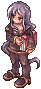{ align=right loading=lazy }

Quer um nome novo, outro visual ou mais espaço? O Resgatador ([Central do Aventureiro](../npcs/central-aventureiro.md)) troca os cupons da loja de cash:

| Cupom | O que faz |
|---|---|
| Cupom de Troca de Nome | Libera a troca de nome do personagem. Depois é só usar o botão de mudar nome na seleção de personagem. Precisa sair do grupo e da guilda antes |
| Cupom de Troca de Sexo | Troca o sexo do personagem (você é desconectado). Bardo, Menestrel, Odalisca e Cigana não podem trocar |
| Cupom de Nome de Guilda | O líder pede o nome novo; a troca é feita pela equipe na próxima manutenção do servidor |
| Cupom de Vaga de Personagem | Mais uma vaga de personagem na conta (até 15) |

## Banqueiro

{ align=right loading=lazy }

Guarda o seu zeny no banco. O banco é da **conta**: todos os seus personagens usam o mesmo saldo.
Você também abre o banco em qualquer lugar com **`Ctrl + B`**.

## Cambista do Bilhão

Fica em Prontera (160,178).

Troca **1.000.000.000z** por uma **Ficha de 1 Bilhão de Zeny**, e a ficha de volta por zeny.
Serve para guardar mais que o limite de 2 bilhões que dá para carregar.

## Sala de Galhos

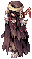{ align=right loading=lazy }

O **Contratante** ([Central do Aventureiro](../npcs/central-aventureiro.md)) aluga uma sala particular por **120 minutos** por **1.200.000z**:

- Para você, para o seu grupo ou para a sua guilda. A sala é **particular**: ninguém de fora entra.
- Todos podem sair e voltar quando quiserem enquanto o aluguel durar (fale com o Contratante e escolha "Voltar para a sala alugada").
- :warning: **Galhos (Galho Seco, Galho Sangrento e parecidos) só funcionam dentro da Sala de Galhos.** Em qualquer outro lugar eles não são usados.

## Sala de Treino

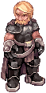{ align=right loading=lazy }

O **Treinador** ([Central do Aventureiro](../npcs/central-aventureiro.md)) abre uma sala só sua (2 horas) com **bonecos de treino** para testar a sua build. A sala já abre com um boneco (do jeito que você montou):

- Escolha o **tamanho**, a **raça**, o **elemento** (e o nível do elemento), se é **normal ou chefe** e a **defesa**.
- Os bonecos não andam, não atacam e têm 1 bilhão de HP. Até 10 por vez.
- Dentro da sala, use **`@boneco`** para criar ou trocar os bonecos.

## Troca de Cartas

{ align=right loading=lazy }

Troca as cartas que você não quer mais por pontos: **10 pontos por carta**. Cartas de Besouro-Ladrão (comum, fêmea, macho e ovo), Tarou e Plâncton não são aceitas.

| Prêmio | Pontos |
|---|---|
| 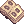 Velho Álbum de Cartas | 170 |
| 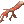 Galho Sangrento | 120 |
|  Moeda de Loki | 1 |

## Forjador de Armas

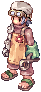{ align=right loading=lazy }

Traga a arma **equipada e em +10**. A chance é de **50%**; se falhar, **a arma some**. O refino e as cartas não passam para a arma nova.

| Arma +10 | Vira |
|---|---|
| 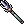 Tridente [2] | 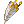 **Lança Gigante [2]**: velocidade de ataque -10%; pós-conjuração -15% no +7, mais -15% no +8 e mais -15% no +9. Lorde e Paladino, nível 85 |
|  Machado Vecer [2] |  **Chave Dourada [2]**: indestrutível, FOR +3; Crítico +20 no +7, velocidade de ataque +10% no +8, ATQ +50 no +9. Mestre-Ferreiro, nível 85 |
|  Arco de Orc | 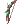 **Arco Élfico [2]**: veja em [Itens](../mudancas/itens.md#arco-elfico) |

## Gerente de Builds

{ align=right loading=lazy }

Fica na [Sala VIP](../npcs/sala-vip.md) (51,26). Guarda até **10 builds de atributos** e **10 de habilidades** por personagem, com o nome que você quiser.

- **Carregar** uma build custa **100.000z**.
- Uma build de habilidades some se o personagem mudar de classe.
- Uma build de atributos fica escondida se o seu nível for menor que o nível em que ela foi salva.

## :mag: Procurar lojas (@ws e @wb)

| Comando | O que faz |
|---|---|
| `@whosell` ou `@ws` (sozinhos) | Abrem a janela **Busca de Lojas** do jogo: escolha Vender ou Comprar, escreva o nome do item (e, se quiser, a carta e a faixa de preço) e clique em procurar. Procura em todos os mapas, até 99 buscas por vez, e dá para abrir a loja de quem aparece na lista sem ir até ela |
| `@whosell <item>` ou `@ws <item>` | Abre a mesma janela já com quem **vende** o item. Aceita o **número do item** (ex.: `@whosell 2302`) ou o nome, e a faixa de preço (`@whosell 2302 0-500000`). Na janela, escreva o nome do item: lá ela não aceita o número |
| `@ws2 <item>` | Lista quem está **vendendo** o item, do mais barato para o mais caro, com o mapa e a posição (`/navi`) |
| `@ws2 +4 2302 0-500000` | Só itens +4 ou mais, de 0 a 500.000z |
| `@wb <item>` (ou `@wb2`, `@whobuy`) | Lista quem está **comprando** o item, do que paga mais para o que paga menos |
| `@wb 969 45-60` | Só quem paga de 45 a 60z |

Funciona com o nome do item (em português, pode ser só um pedaço) ou com o ID. Não importa se você escreve com maiúsculas, minúsculas ou sem acento. Lojas em `@at` também aparecem.

**Loja de compra:** a **Licença de Loja de Compra** custa 20 Moedas de Loki na Trocadora de Moedas (Blackroom). Ela abre uma loja que **compra** até 5 itens (itens comuns e consumíveis). Use `@at` para deixar a loja aberta enquanto estiver fora.

## :scroll: Resumo da loja

Quando você fecha a sua loja de venda, aparece no chat um resumo de tudo o que aconteceu desde que ela abriu:

- **o que foi vendido** (quantidade e quanto zeny cada item rendeu);
- **o total recebido** (já sem a taxa, quando houver);
- **o que sobrou na loja** (quantidade e preço de cada item que ninguém comprou).

O resumo só aparece para quem está com o jogo aberto. Uma loja deixada aberta com `@at` fecha sem resumo.

## :gear: Configurações que ficam salvas (@config)

Digite **`@config`** para abrir uma janela com os comandos que você quer sempre ligados. O que você escolher volta sozinho toda vez que o personagem entra no jogo:

- Autoloot (até 1%, 10%, 50% ou todos os itens)
- Autoloot por tipo (cartas, equipamentos, consumíveis ou tudo)
- Até 10 itens específicos para o autoloot
- Recusar negociação e convites (`@noask`)
- Mostrar a EXP e o zeny ganhos (`@showexp` e `@showzeny`)
- Proteção contra roubo de monstro (`@noks`): ninguém de fora do seu grupo tira o monstro que você está atacando
- [Proteção de itens](#protecao-de-itens) (vale para a conta toda)

**Sem digitar:** todo personagem recebe o **Painel de Configurações**, um item que abre esta mesma janela. Arraste o item para a **barra de atalhos** (F1 a F9) e clique nele, ou aperte a tecla, para abrir. Ele não é gasto, não pesa e não sai do inventário. Se não estiver com você, ele volta na próxima vez que você entrar no jogo.

## :lock: Proteção de itens

Para ninguém perder item bom por engano, com a proteção **ligada** (já vem ligada) estes itens **não podem ser vendidos para NPC nem largados no chão**:

- cartas;
- ovos de pet;
- visuais;
- equipamentos com refino **+7 ou mais**.

Lojas de jogador, trocas, correio e NPCs como o Reciclador de Cartas continuam normais. Para desligar ou ligar: **`@protecao`** ou no menu do **`@config`**. Vale para todos os personagens da conta.

## :package: Armazém da guilda em toda Kafra

Todas as Kafras das cidades, a Kafra de Prontera e a Kafra VIP abrem o **armazém da guilda** para quem está numa guilda.
A guilda precisa ter aprendido a habilidade de guilda do armazém, e o seu cargo precisa ter permissão para usá-lo
(o líder libera na janela da guilda).

## :zzz: Jogador parado (AFK)

Quem fica **1 minuto sem fazer nada** ganha um "zzz" em cima da cabeça, para os outros saberem que você está fora.
Ele some assim que você se mexe. Quem está com loja aberta não ganha o "zzz".

## :art: Skins da interface

O jogo vem com **71 skins** para as janelas. Escolha a sua em **Opções** (tecla Esc → Opções → Skin).

## :slot_machine: Roleta da Sorte

A **Roleta da Sorte** abre pelo botão do menu do jogo. Cada giro dá um prêmio; se cair numa casa boa, você ganha **um giro grátis no nível seguinte** (são 7 níveis, os de cima com prêmios melhores). Se cair na casa de consolação (Moedas de Loki), ganha as moedas e a roleta volta ao começo.

Para girar, use uma **Ficha da Roleta** (dá 1 giro):

| Ficha | Começa no | Onde conseguir |
|---|---|---|
| 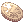 Bronze | 1º nível | Trocadora de Moedas (30 Moedas de Loki) |
| 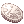 Prata | 3º nível | Gerente de Moedas Douradas (150 Moedas Douradas) |
|  Ouro | 5º nível | Loja de cash e loja das [Fichas de Facção](faccoes.md#loja-das-fichas-de-faccao) (10 Fichas) |

Prêmios: Bandeiras, poções, Yggdrasil, Manuais e Gomas, Moedas Douradas, Caixas Misteriosas, Velho Álbum de Cartas, Fichas da Roleta, Caixa de Visuais, Ovo Misterioso, Martelo de Refinar Carta, Bilhete VIP 5 dias, Álbum de Cartas Lendário e, no último nível, Pergaminho de Refino de Arma +10.

